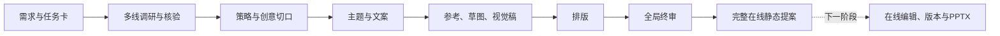

> 最新：[终审与交付页面](output/qingyu-delivery-20261111/README.md)已按成稿、终审摘要、交付调整，比较默认收起。青屿复用23页演练稿，正式状态未放行。实际UI及源码审查完成；新下载文件未绑定，旧静态入口恢复原字节，本轮入口使用4417。

> 最新：[七阶段与青屿23页排版](output/qingyu-layout-20261111/README.md)已更新原4415。独立内容审阅移除，检查职责并入比稿Agent，视觉后直接进入排版；原审阅记录只读保留。沿用版式工坊、研究9页、策略3页和当前三方向原文原图，实际浏览器逐页、下载及UI复验完成。排版后终审保留，尚未签通过。

> 历史：[内容审阅页与实际审读](output/qingyu-content-review-20261110/README.md)保留原件。其独立前台环节已由2026-11-11决定退役，原三项未决作为随稿限制保留，不能将页面移除当作问题已获得业务批准。

> 此前：[视觉页UI审核与完整补图](output/qingyu-visual-ui-fill-20261110/README.md)已更新原4415。3主图、9构图探索与3三视角样机板已真实生成，六真实参考保持；规范收起、协作前置，实际浏览器验收完成。仅设计试稿，不代正式阶段准入。

> 最新：[视觉开发原版式恢复](output/qingyu-visual-layout-repair-20261110/README.md)已更新原4415。按用户退回意见恢复大图与右评审、三纸页文件夹和全宽参考，规范与协作默认收起；已完成真实浏览器复验，未制作新视觉稿。

# AI 创意提案工作台

[现行工作流与职责](docs/workflows/提案工作流_现行规则.md)记录比稿 Agent 逐阶段检查、七阶段前台、既有方法与版式复用及每轮 UI 审核。排版前不设独立内容审阅页面或负责人，排版后保留终审。当前页面与接入范围以上方最新交付为准，通用自动编排尚未完成验收。

最新[青屿包装参考实图](output/qingyu-packaging-references-20261110/README.md)已填入原4415。三个封存文案方向各两件实际包装，每件附借鉴句和品牌来源；原布局保留，草图、精修与评审尚未进行。

此前[青屿视觉布局预览](output/qingyu-visual-layout-20261110/README.md)已更新原4415，保留三方向、参考扇面、草图文件夹、左图右评审、样机与对照。只读图位供看布局，未制作视觉或评分，后续再讨论简化。

从设计需求生成有来源的研究、策略、文案与视觉，再形成横向逐页、可在线编辑并导出可编辑 PPTX 的静态提案。首版覆盖 KV 和包装设计，支持自动模式及按模块参与的辅助模式。

**当前前端采用中文桌面版，并已加入本地真人协作演示。** 当前[入口与截图](output/frontend-team-20261108/README.md)包含右上角在线成员、统一角色权限、意见处理与负责人通知。真实账号、跨设备同步、夜间后台及外部消息尚未接入。已删除外语切换与手机模式。入口、截图和使用者视角的信息减法建议见[当前交付说明](output/frontend-desktop-cn-20261108/README.md)。原定版保持原位，优化版本仍明确区分本地演练与公开资料，尚未接入真实业务。青屿现有内容已形成23页排版预览，未签正式业务或排版后终审；得闲后台续跑仍受原暂停边界约束。在线修改、编辑保存和恢复继续暂缓。真实模型质量、实际计费、资金系统及受限鉴权未改。

## 从这里找到当前工作

- [青屿视觉流程与负责人规范](output/qingyu-visual-workflow-20261110/README.md)已更新原4415。参考待评、方向任务、同阶段对照、紧凑空稿和侧栏协作使用同一输入；项目视觉负责人 Skill 已固定版本，并实际接续六件原图。没有生成草图、精修、样机或业务视觉评分，后台自动编排未因此接通。
- [青屿文案完整重做与实际页面](output/qingyu-copy-full-20261110/README.md)已更新原4415。两轮真实创作、四角色独立模拟评分、四对应对抗及独立总监裁决；正文三方向和推荐，具体评分、异议与修改记录收起。原3分与原岗复核4分并列，未写客户批准或方向获选；原策略和暂停项保持。
- [策略三环版式与文案第一稿](output/strategy-rings-copy-20261110/README.md)已更新原4415。第二页改为研究/产品/用户三环与右侧结论，策略文字及首末页保持。已实际点击下一步进入文案，三个只读初稿可展开理由与备选短句，未写入方向选择或正式业务批准。
- [策略负责人基础要求与三板块](output/strategy-owner-simple-20261110/README.md)已更新原4415。按最新决定停用新策略推导的强制Skill，页面只保留研究结论、方向交叉点与策略发力点，复用研究版式。原稿和评审留作历史；具体产品输入与待补依据分开标明。
- [青屿策略第三版方法重推](output/qingyu-strategy-r3-20261110/README.md)已更新原4415。用户补充虎跑泉用水后完成两稿及品牌方、目标用户、独立策略三方复核。范围仅定位建设与优先验证，购买作用仍待证；未写消费者文案或创意画面。
- [青屿策略退回与方法暂停的历史记录](output/qingyu-strategy-rejection-20261110/README.md)。用户否定过策略r2稿02；r2原件及原审查保留，当前由上述r3项目方法替代，旧桌角内容不再作为推荐。
- [策略Skill r2独立质疑机制](output/strategy-independent-review-r2-20261109/README.md)已保存项目版本：保留创意自由，由隔离的品牌方与目标用户视角审查，修改后核同一版本。一次合成文本案例已实际完成两轮回环，旧青屿页面和r1身份保留，正式业务编排未接入。
- [青屿策略r1历史应用与产物](output/qingyu-strategy-20261109/README.md)保留原稿、21条推导和当时独立审校身份；原4415当前页面为上列r3，不把旧稿改称新方法生成。
- [版式工坊双入口接入](output/deck-studio-integration-20261109/README.md)已更新原4415。研究默认五章九页固定图版，整案版式与交付中心复用同一内核和PPT导出器。已用青屿研究与北线16页工程案例实际下载验证，项目Skill r7记录模板规则。青屿仍研究待补，旧报告和原生成身份保留，正式业务与编辑保存验收未恢复。
- [青屿研究修订4与可编辑报告](output/qingyu-research-r4-20261109/README.md)已更新4415研究页。项目Skill r6先区分正文/详情/排除资料，再补人群情景、七品牌分组比较与跨维综合；五章六图版，保留四件清晰原图和可编辑图表，底部单一下载10页原生PPTX。研究仍待补，未接正式自动编排或恢复整案。旧修订2/3与保存稿继续可切换。
- [开发状态导航](status/current.md)列出当前唯一最终案例、历史节点及剩余验收。
- [后续待办](status/backlog.md)登记后端完成后接入定版前端的任务；[后端整合交接版](docs/handoffs/提案工作台后端开发说明_整合交接版_20261104.md)供并行开发核对。
- [模块与实现地图](docs/architecture/overview.md)连接输入、输出、代码与测试。
- [产品 Agent 分工](docs/architecture/agent-map.md)区分业务岗位、评审和开发协作 Agent。
- [Memory 与上下文](docs/architecture/context-map.md)说明实际状态存储及读取边界。
- [Skill、服务与工具索引](docs/integrations/index.md)区分已安装、实际接入和暂缓能力。
- [资源与案例索引](docs/resources-index.md)、[业务案例入口](projects/README.md)指向原件，不复制数据库。
- [存储与保留规则](docs/storage-retention.md)说明哪些内容可再生成、哪些必须保留。

## 业务流程

下面是最新目标流程，不是全链路已通过声明。比稿Agent在各阶段和排版前检查衔接，排版后再做全局终审。



有效业务依据保留在[开发说明 v0.3](多线调研工作台_开发说明_v0.3.md)及[工作流规则索引](docs/workflows/提案工作流_现行规则.md)。该索引包含历史暂停和历史能力描述，冲突时按最新用户决定及实际记录判断。此次整理不修改业务合同或放行标准。

## 应用和启动入口

| 入口 | 实际用途 | 当前限制 |
| --- | --- | --- |
| [正式前端源码](apps/proposal-workbench/README.md) | React、TypeScript、Vite 的前端交接工程 | 定版展示包已另存；等当前后端节点完成后接入，本轮不改版式或组件 |
| [独立验收服务](tools/local-acceptance/launch-complete.mjs) | 本地合成流程、在线编辑与导出接线 | 常驻 4450 是既有 legacy 配置；新 V2 仅在隔离根做过启动、创建与重开验证 |
| [普通后端启动说明](NORMAL_LAUNCHER.md) | 配置式后端服务入口 | 文档含早期限制，不作为当前完整验收证明；现阶段不启动真实服务调用 |
| [历史展示样板](sites/light-baijiu-research/) | 梦之蓝、轻型白酒等历史提案与动画原型 | 历史稿不是本目标最终验收样本 |

新建隔离 V2 验收环境需要本机工具和字体配置，命令入口为：

```sh
LOCAL_COMPLETE_REFERENCE_PROFILE=local-reference-pool-v2 \
LOCAL_COMPLETE_NATIVE_CONFIG=/absolute/path/native-config.json \
node tools/local-acceptance/launch-complete.mjs
```

V2 默认使用新数据根和 4460、4461 端口。不要将旧数据根改为 V2；启动配置和项目记录会拒绝错版。命令只启动服务，不代表调研、评审或导出已经通过。当前旧服务及活跃两案的路径见[实际运行记录](.scratch/end-to-end-local-20261102/ACTIVE-RUNS.json)。

## 开发和验收入口

开发者先读 [AGENTS.md](AGENTS.md)，再按当前任务选择模块地图中的代码和测试。测试源码与必要夹具保留在实现旁；`.scratch` 同时保存正式任务、候选、失败和独立审查，不能整体清除。

本次节点只增加导航和保存规则。原路径对应关系见[本轮整理记录](status/checkpoints/2026-11-03-navigation.json)，没有搬迁源码、原件或数据库。
