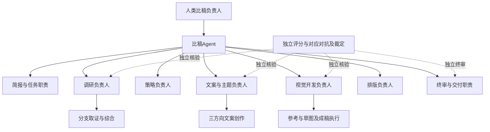
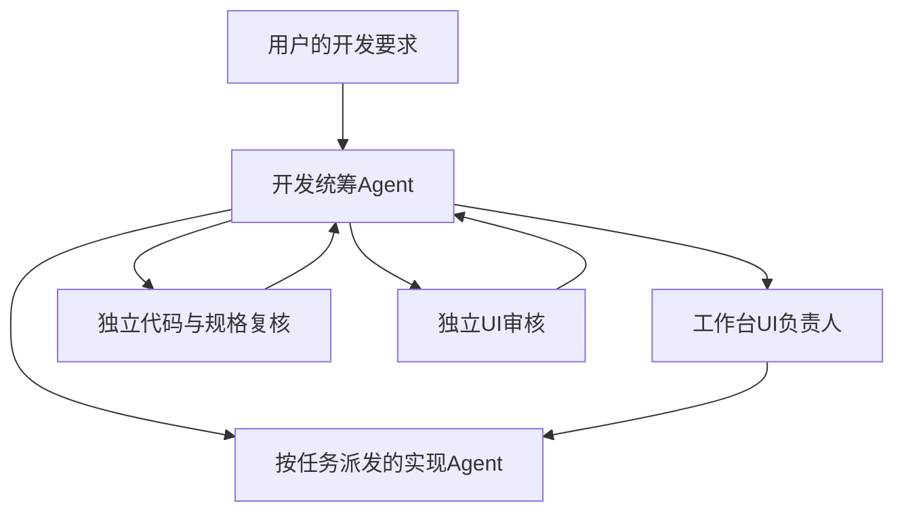

# Agent组织与职责总览

规范版本：1.0.0。用于任务派发和责任查询。岗位是责任边界，不要求常驻进程，也不绑定某个模型。本轮补齐组织与开发职责，不宣布自动编排已经实现。

## 两条统筹线

提案业务由比稿Agent统筹，人类比稿负责人保留项目决定权。工作台开发由开发统筹Agent组织，业务负责人提供内容与状态合同，工作台UI负责人维护跨页基线。开发统筹不能代签业务批准，业务统筹不能用内容评审替代代码和UI验收。

简报职责现由比稿Agent承担，终审职责由比稿Agent组织独立执行。二者有独立合同，不表示必须再建两个常驻Agent。策略维持基础检查，不因上图增设固定多岗评分。

独立指未参与对应产物创作、按限定输入执行。上下文隔离、不同模型、真人批准和消费者实测分别记录。没有实际调用时保留未执行，不能用图上的节点冒充运行记录。

## 岗位及内部运作

| 岗位入口 | 内部工作与执行者 | 交出什么、问题退给谁 |
| --- | --- | --- |
| [比稿Agent](proposal-director.md) | 派发阶段负责人，逐阶段检查任务与逻辑承接，排版前简短核对 | 有效交接或新增问题；退所属负责人，保留人类决定 |
| [简报负责人](brief-owner.md) | 比稿Agent整理任务卡，有权限的人确认 | 单份任务卡与真实确认状态；事实不明回用户 |
| [调研负责人](research-owner.md) | r7 Skill组织市场、人群、竞争、产品分支，负责人综合；独立核验和读者回环分开 | 五板块、证据与缺口；关键缺口仍研究待补 |
| [策略负责人](strategy-owner.md) | 核研究、产品与用户的交叉点，说明优先发力 | 三板块，两三页；缺证退调研，事实退简报 |
| [文案负责人](copy-owner.md) | 创作三方向；文案、品牌、模拟用户、传播四岗独立评及四对应对抗、独立裁定 | 当前主副文、推导与原评；文案自己改稿、独立同版复核 |
| [视觉负责人](visual-owner.md) | 固定Skill组织参考、草图、深化、成稿与样机；四岗评分、对应对抗和裁定在创作链外 | 实际图及版本和准入；适用性回参考、结构回草图、美术回深化 |
| [排版负责人](layout-owner.md) | 用既有Deck Studio 1.7模板组案，逐页与导出核对 | 同版Deck及原生导出；内容主张退原负责人 |
| [终审负责人](final-review-owner.md) | 按[终审协议](../specs/final-review.md)组织实际页审读、异议和独立裁定 | 绑定产物的结论、问题及交付范围；逐项退所属岗位 |
| [独立业务评审者](independent-reviewer.md) | 按当前阶段扮演评审、对应对抗或裁定，分别运行 | 原票与有据结论，保留未知；不能改原票或替作者补证 |
| [开发统筹Agent](development-lead.md) | 定任务范围与依据，派发实现、独立复核及UI检查 | 可审差异、实际验证与未接线范围；不推进业务阶段 |
| [工作台UI负责人](workbench-ui-owner.md) | 维护共享外观、逐页结构和组件边界，组织跨页复验 | 页面基线与实现约束；业务内容问题回业务负责人 |
| [UI审核者](ui-review-owner.md) | 按项目固定Skill检查真实运行页面和交互 | 前后证据、问题处置和未验状态；不签业务通过 |

各岗位的固定方法与阶段门槛以表中原岗位文档为准。研究和视觉继续读取现有Skill，策略保持简洁要求。执行者数量按任务与依赖确定，不为七阶段每次重造一套方法。

## 派发、交接与退修

派发与验收共用[阶段交接合同](../specs/handoff.md)。上游生产者提交原件与自查，下游负责人核对同版输入并明确接收、退修或待核，比稿Agent检查衔接。生产者不能用自己的自查替下游签收。

阶段评审由当前负责人组织，独立角色按原稿分别保存原票。比稿Agent汇总有效结论；人类节点由真实有权限的人作决定。上游改版后只重核受影响范围，旧通过保留历史身份。

页面责任、逐页差异和辅助页待定范围见[页面索引](../pages/README.md)。工作台界面UI由UI负责人维护，提案Deck的内容版式由排版负责人维护，二者的检查相互衔接。

## 当前落实边界

注册表与字节锁已约束岗位、页面和方法版本。它们校验规范身份与引用，不调度Agent、不证明遵守了语义规则。通用真实模型编排、正式服务、权限、通知和在线PPT保存恢复仍按原边界暂停或待接。

本轮开发统筹和UI负责人是明确的执行职责。当前由开发会话人工编排，尚无持续运行、自动巡检或自动派发的岗位服务。青屿本地演练及其独立审读记录不等于任意Brief均能自动完成。
