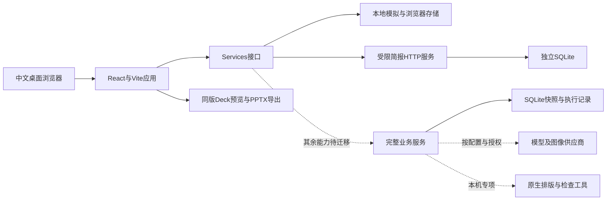

# 应用与Agent运行架构

规范版本：1.2.2。本文件描述当前模块与边界；历史实现和回执索引仍保留在[原架构记录](overview.md)。岗位责任以[Agent组织](../agents/README.md)为准。旧实现与当前接线分别见[六线对账](../development/capability-reconciliation-20261111.md)，未接页面不等于底层模块未实现。

## 当前前端

`apps/workbench-preview/src/App.tsx`装配应用、路由、服务、主题、人类协作和WorkBot。`src/app/router.tsx`负责hash路由，`views/ProjectWorkspace.tsx`装配五项目区域；`ProposalArea.tsx`装配七生产阶段。页面ID与实际路由映射见[页面索引](../pages/README.md)。

`src/domain`定义服务和模型，`src/services/index.ts`选择实现。默认工作台、提案和助手为Mock，本地Brief解析另有实际提取能力。HTTP模式用HttpWorkbenchService与HttpProposalService读取同一真实快照，完成项目和简报读写，研究原件另有真实读取。brief-server默认没有执行器，显式配置可执行指定研究job，不扫描恢复旧任务。HTTP助手及后续生产未迁移此入口，旧助手后端已有实现与限定工程证据。DTO、Brief封装、重试与业务版本见[简报HTTP合同](../development/http-brief.md)和[研究接续](../development/seven-stage-research.md)，设置地址本身不代表连接成功。

`src/services/proposal`及`collaboration`负责本地提案、角色、修订和草稿保护。本地权限矩阵不等于生产身份服务；浏览器持久化不是远程数据库。案例投影在`src/proposal/qingyu-*`，依输入、版本与哈希守卫只读显示原稿和原评，不能反写正式阶段通过。

`src/proposal/deck-studio`及其适配输出同一Deck，预览与PPTX共用页面数据。文字、图表、形状及图片分别保留；图片内部文字仍是像素。工作台UI由UI负责人维护，Deck页面由排版负责人维护。

## 业务后端与工具

| 模块 | 输入与输出 | 实现入口与依赖 |
| --- | --- | --- |
| 受限简报与研究HTTP | 项目与任务卡、来源、研究原件及核验，输出真实快照与重放回执 | `brief-server.mjs`默认store与域；显式研究配置只执行指定job，不扫描或恢复旧任务 |
| 任务与业务域 | 命令、当前修订和权限输入，输出新状态或明确拒绝 | `tools/workbench/project.mjs`、各阶段合同 |
| 存储 | 版本、head、执行与回执，读取可信快照 | `store.mjs`，Node SQLite，业务数据在`.data` |
| 派发与恢复 | 有效任务和资源边界，输出job、attempt和原生执行记录 | `executor.mjs`、`server.mjs`内部pump/schedule及`recovery.mjs`；没有独立scheduler.mjs |
| HTTP与配置 | DTO及实际供应商配置，输出受限接口和结果 | `server.mjs`、`launch-config.mjs`；不能从界面示例推断接通 |
| 研究与创意 | 证据、当前稿、隔离评审输入及能力配置 | 研究、文案、参考、草图及视觉各runtime；与最新简化岗位规则仍需对接核验 |
| 正式终审 | 可信快照、实际多版原生页及覆盖义务 | `final-review-*`等模块；能力、签收和最终交付不能由规划器输出替代 |
| 排版与原生证明 | 结构化内容、图像、字体及图表 | `tools/auto-layout`；私有运行库及本机原生工具尚未完整可移植 |
| 本地联调 | 合成输入、实际命令回执与恢复情景 | `tools/local-acceptance`；不是线上用户服务 |

后端历史存储形状可能保留旧八阶段身份，当前前台使用七阶段；不删除旧内容审阅记录，也不因此让旧业务流程自动放行。后端与新岗位规则的衔接须单独验收。

## 数据、上下文与审核

开发规范由注册表与字节锁管理，运行上下文按当前任务取必要原件。项目状态以原生存储和回执为准，摘要只作导航；没有新增向量记忆或自动偏好学习服务。当前具体位置见[上下文地图](context-map.md)。

业务内容、阶段承接、代码实现、实际UI、排版后终审、人类决定各有证据与权限。[交接合同](../specs/handoff.md)要求同版输入、产物、真实签收与退修范围，[终审协议](../specs/final-review.md)限定实际看图及五职责独立关系。

源码进入Git只增加可审查与回退能力，不恢复得闲旧run、付费服务、外部通知或在线PPT编辑保存。模型实际接入、真实账号、无人值守调度和正式全链路仍是后续工作。

## 新七阶段协议

`seven-stage-workflow.mjs`定义proposal-seven-v1身份与只读状态；project保留旧STAGES并对新协议另设执行守卫。`research-method.mjs`绑定实际r7方法字节，executor和原生回执核同一请求。`research-service.mjs`只处理指定研究任务，无全库恢复或续接；brief-server增加受限研究路由。当前HTTP研究读取使用researchProjection和R7ResearchView，默认执行关闭。reader_loop未满足时拒正向交接和正式放行，详见[运行合同](../specs/seven-stage-runtime.md)。

## PDF原件bridge

brief-server复用brief-intake-service→旧intake-runtime/intake-document-store保存原字节与intakeOperations，沿用同一project store；只新增受限documents路由，无schedule/recover。上传附带PDF解析queued零attempt job，前端仅按真实bridge登记关系窄投影；卡原始身份、客户端选择ID、服务器文档ID与字节SHA分别核。HTTP/Mock资料位置说明分开，见[原件合同](../development/brief-originals.md)。
