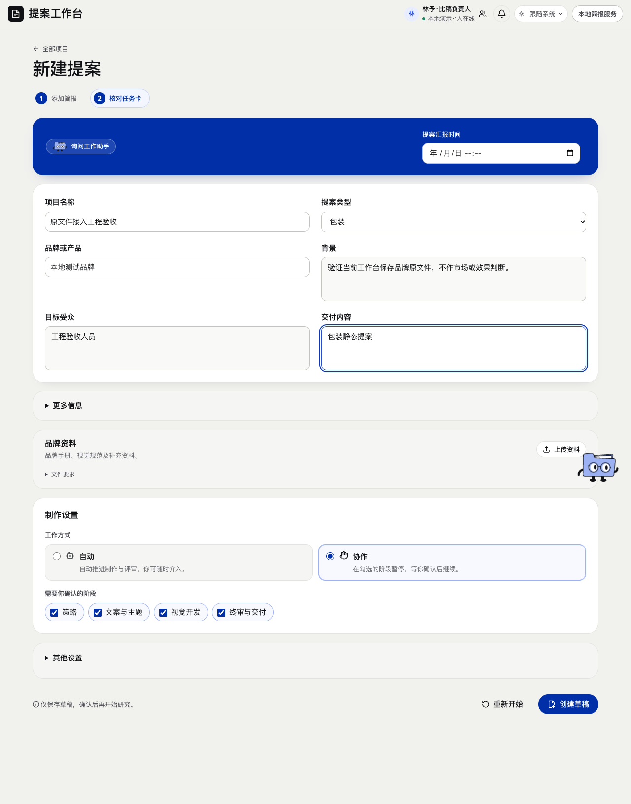
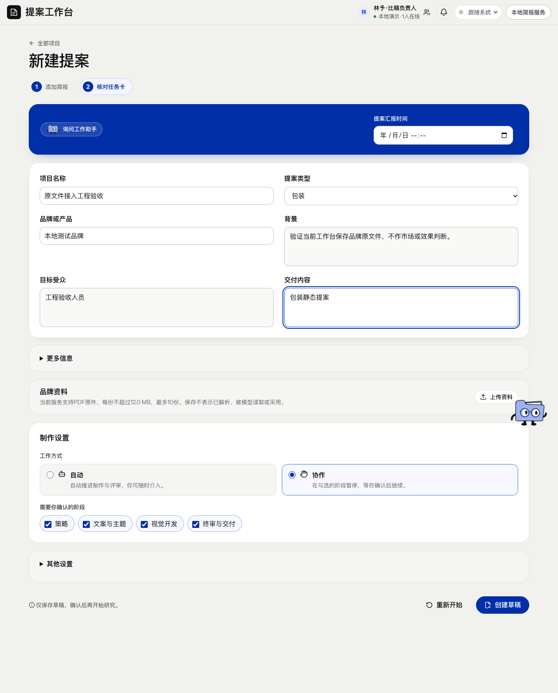
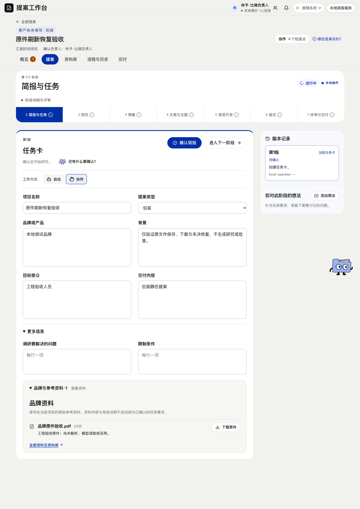
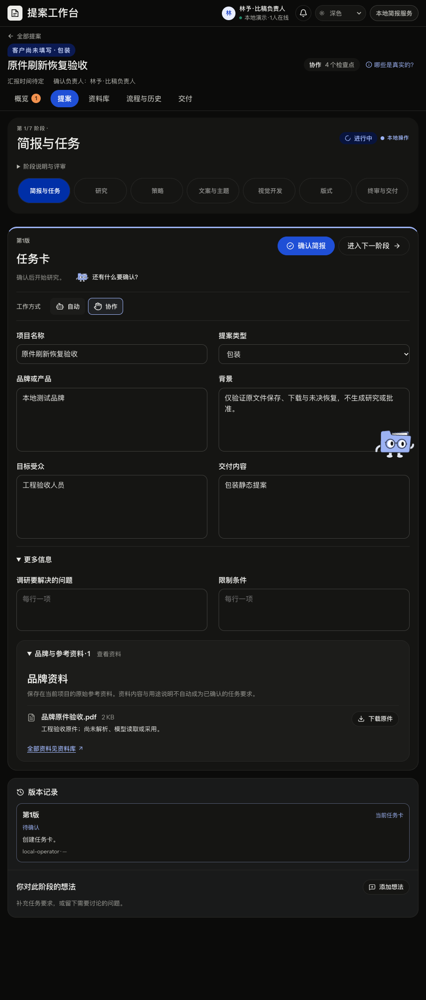

# PDF原件接入实际核验

2026-11-11，源码起点fd3f5a1791c9d3699d34d16d68582daf980fd57a。当前目标仍是整个七阶段本地静态闭环，本记录仅交付输入中的PDF原件子路径，研究读者、采集及后续生产没有因此放行。

## 已实现和实际证明

- 复用旧intake/受控对象存储，在当前HTTP与页面保存、投影、下载原PDF，原文件选择身份和服务端document ID分开。
- 原件bridge9项、HTTP2项和既有受限服务11项覆盖未确认保存、字节与重开、原请求重放、跨项目、错版历史、原件损坏/符号链接、格式/元数据边界、零执行和现有请求守卫。
- 前端原生HTTP/新SQLite与Blob回归，核创建前预检、窄intake job、同体恢复、SHA下载、权限wrapper及Mock兼容；完整当前前端723项通过、1项既有跳过。类型检查通过，最后UI窄改另由实际页面复验。
- 独立Spec与Standards复核修复一项跨层元数据问题：原后端允许带clientResourceId的note超过前端1000字，保存后投影拒绝；现于上传前按客户端可表示范围拒绝，普通无client ID的旧intake范围保留。原问题与独立反例未删除。

## 真实浏览器、恢复和原文件

当前隔离入口为4424/4184，新SQLite位于本机`.scratch/seven-stage-static-goal-20261111/ui.sqlite`。未使用旧项目或用户浏览器会话。Chrome真实创建携带PDF的未确认任务，上传实际落库后故意丢弃响应，刷新后点击核对原提交，两个POST body完全相同。核对回Brief，展开既有更多信息/品牌资料，再下载原件。

[UI回执](evidence/originals-20261111/UI-ORIGINAL-RECEIPT.json)绑定项目、1811字节原PDF及SHA。当前项目原件1份、解析器job1个、attempt0、confirmation0，无研究或模型调用。910桌面scrollWidth=910、topbar=0，未记录pageerror。下载文件与上传fixture逐字节相等；这不是PDF内容解析或市场质量检查。

首次检查脚本错误等待默认收起的资料区可见，第二次展开使用文本定位同时命中summary与隐藏legend。这两次脚本失败没有当作应用通过，也没有据此重试未知业务。第二次成功恢复的原POST和项目保存在本机UI-ORIGINAL-PARTIAL.json，后续只读接续展开、下载及看图，不再创建/上传；失败项目和截图保持。最终回执据该实际原件与接续结果生成。

## 独立UI与范围

独立UI审核使用临时Chrome只读复验1280浅色/910深色、实际PDF能力、展开和下载及键盘焦点，记录POST0；它不重复创建、上传或确认，也不代替根的恢复回执。发现新建页文件要求重复常显能力提示，已窄修：HTTP保留常显实际能力，移除重复详情，Mock原文件要求保持。20原则、最终复验及范围记录在本机`design/intake-ui-review.md`。

本轮没有执行PDF解析、模型提取、图片/Office等其他品牌格式存储、真实供应商或正式采用；没有恢复旧run、在线编辑或生产账号。r7读者纯协议和简洁策略另有隔离候选，未因本文件签入运行或补成通过。后续先接同版读者原件/交接与采集，再按目标工作包串联。

## 独立UI原则处置原表

以下为独立只读审核的原范围记录，来源身份见[证据索引](evidence/originals-20261111/EVIDENCE-SOURCES.json)。没有把无法验证项合并为通过。

|原则|处置|本轮证据或限制|
|---|---|---|
|01产品气质|已满足|两页保留蓝色/中性色、原卡片与导航角色|
|02灰度基础|无法验证|未做灰度截图，不用彩色观察替代|
|03文字层级|已满足|标题、字段、文件名/用途分层，两种viewport无截断发现；精确对比度见14限制|
|04减少竞争|已满足|当前阶段、确认/创建与下载层级可辨；下载焦点可见|
|05冗余标签|已满足（原P3已解决）|最终New仅一份常显能力说明，HTTP无重复details；见最终复核|
|06操作层级|已满足|观察到主要操作与次级下载区分；提交/危险操作按只读约束未执行|
|07留白|已满足|资料名称、用途、下载间距不拥挤|
|08内容宽度|已满足|1280/910无测得横向溢出|
|09信息归属|已满足（原P3已解决）|最终New品牌资料归属清楚，重复详情已移除|
|10屏幕比例|已满足|910版本栏移到任务卡下，两种宽度资料可读可操作|
|11行长行高|已满足|实际中文资料说明正常换行，无重叠发现；未测200%放大|
|12混排对齐|已满足|文件名/大小与下载操作在两种viewport保持可辨对齐|
|13语义色阶|无法验证|未枚举所有hover/disabled/error的计算样式|
|14实测对比度|无法验证|本轮未计算全部前景背景对比值，不能宣称WCAG通过|
|15非颜色线索|已满足|待确认、未解析/读取/采用为文字，文件与下载有图标/名称|
|16局部边界|已满足|任务卡、选中阶段、下载键盘outline具有边界，无需新增|
|17图片上文字|不适用|本次资料接入区没有图片叠字|
|18素材尺寸|已满足|现有文件/下载图标在DPR1实际尺寸可辨；未覆盖其他DPR|
|19必要边界|已满足|原输入框/卡片边界保留，下载焦点实际可见；未测高对比模式|
|20空/错状态|无法验证|仅空白任务卡正常态与既有文件态；未触发上传/网络失败恢复|
