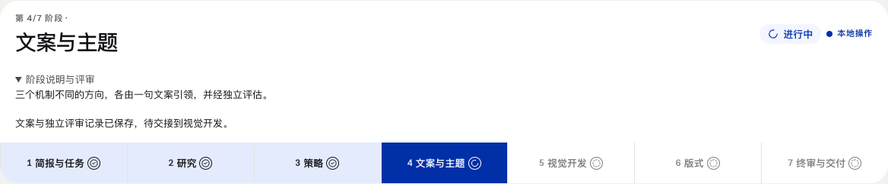
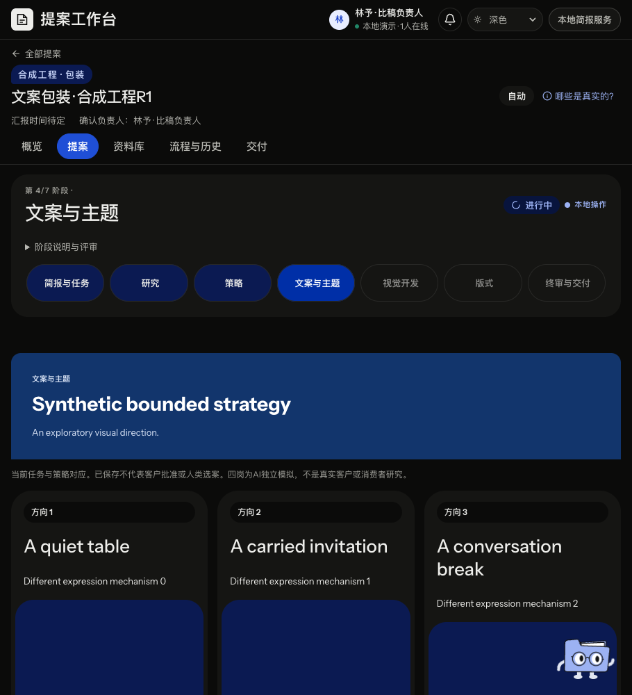

# SIMPLE策略至文案接续核验 · 2026-11-12

当前本地接入：同版SIMPLE策略经实际双负责人交接，生成唯一三方向文案，再登记全文核验和原四岗17节点评审。合同见[文案接续](simple-copy.md)。本页记录实际工程范围；完整七阶段和远程PR结果按后续真实回执补记。

## 实际案例与界面

具名包装合成案例“文案包装 · 合成工程R1”，项目`project-783b3ceba8cad8e9ed9c1cd8de55e49cc404bbb5f7e373f957abd98be2625689`，原根`reader-owner-FyRazA`。实际准备了r7、独立读者、研究核验/交接、研究工程放行及SIMPLE；没有重开旧青屿或得闲业务。它是文案子链验收，不能代替从Brief起的包装/KV两整链。

真实Chrome操作完成双负责人、唯一copy、全文核验及17份原评审。最终revision163、30个实际job各1attempt，queued/unknown均0。文案子链21次唯一调用=双负责人2+copy1+全文核验1+评审17；上游研究策略9次。评审为四岗首读4、异议首读4、评分4、异议4、裁定1，三方向原正文保留。

文案保存响应被主动截断后，刷新使用完全相同的command/body恢复；revision65、任务数、唯一copy调用保持不变。导航和刷新不派发任务。原请求与最终计数见[UI回执](evidence/simple-copy-20261112/creator-ui-receipt.json)和[终态摘要](evidence/simple-copy-20261112/creator-final-summary.json)。

独立UI在同案revision140、12报告/待4任务时延迟真实GET：刷新中全部写入动作禁用，查询实际完成后才恢复继续按钮；0POST且项目不变，见[延迟GET回执](evidence/simple-copy-20261112/independent-refresh-settled.json)。最终同案17份报告及浅深主题已分别只读核对。最后只读重开再次核对“文案进行中／待视觉交接、策略完成”及已保存按钮原因，project、17报告和三方向artifact/SHA/content与前次final完全相等；executionAllowed=false、0POST及错误。见[独立UI报告](evidence/simple-copy-20261112/independent-ui.txt)和[最终读回](evidence/simple-copy-20261112/independent-readback-result.json)。

910宽初始位置及自然滚动到三卡的位置均未隐藏WorkBot，实际标题矩形与其可见元素无交集；该观察不覆盖任意滚动或悬停气泡。页面无横向溢出，三卡局部文字对比13.94:1；没有作整页无障碍合规声明。

合成director原记录同时保留`human:false/outcome:reject`及`creativeStatus/groupVerdict:pass`，人类决定数为0。不能从这些工程票推定真实创意质量、消费者偏好、客户批准或人类选定。

## 修复与保留的失败

首次frontend候选对creative packet、phase和原输入核对不足；r2补齐完整17节点、角色/依赖/packet/task/policy/target/input绑定，并保留合法历史可读。独立检查及候选原工具回执分别见[前端独立审查](evidence/simple-copy-20261112/frontend-independent.txt)和[原工具回执](evidence/simple-copy-20261112/frontend-original-tool-receipts.txt)，后者不是补造的stdout。

真实UI暴露队列刷新窗口可重复提交旧任务组。原生守卫以422拒绝新command；该command没有入账，旧4任务各1attempt且unknown0，见[原拒绝检查](evidence/simple-copy-20261112/rejected-command-check.json)。原错误body未被驱动保存，`INVALID_JOB`只属于源码/状态推断，没有重放来补回执。现页面在查询刷新或刷新失败时阻止新写，系统角色及phase使用中文。

驱动误以为一步完成双负责人、GET竞态提前关闭context、暂停后墙钟超时、Chrome响应缓存丢失及错误禁止全部AI decisions的断言均保留原失败。继续只执行同案剩余原队列；没有重造项目来覆盖失败。详见[creator原说明](evidence/simple-copy-20261112/creator-owner-notes.txt)。

## 原身份与边界

recovered SIMPLE的原attempt仍未知，产物作者保持原executor，恢复者另存reconciliation context。独立从保留SQLite历史revision41/43/44/154/155及10份原IO、19份负责人/评审原件重新计算SHA；revision43恢复receipt后至评审完成，原attempt、作者、receipt、正文与原IO一致。最后问题变化使交接失效，不能把旧评审当当前放行。见[恢复身份独立核验](evidence/simple-copy-20261112/recovered-identity-independent.txt)。

actual claim仍检查原commit、双负责人、当前任务卡/问题/policy/binding和授权；HTTP step仅运行请求冻结的1–4个原任务。显式人工策略checkpoint使用原生adopt-creative及decide/strategy权限，导航不代签。GET投影`originalsVerified:false`，不冒称本次读取已物理复验全部原件。

默认授权仍停研究，只有服务器显式配置影响新项目。文案、负责人及creative未知结果保留并停止，本包不开放它们的恢复重派；文案改稿再评、视觉继续、Deck/PPTX和两整链待接。在线编辑保存/恢复、付费模型、正式服务和旧业务run保持原边界。

## 检查与回执

根类型检查、2项实际前端HTTP测试、25项可移植绑定/合法历史/权限测试、7项原生变化/未知/来源边界已通过。portable快照只保存合成历史metadata，不包含物理原IO，不代替原生验收。精选[HTTP日志](evidence/simple-copy-20261112/root-http.txt)、[边界日志](evidence/simple-copy-20261112/root-boundaries.txt)及[类型日志](evidence/simple-copy-20261112/root-typecheck.txt)保留实际输出。

完整根检查、最终两轴审查和PR/CI仍在收束；不由以上专项推定全部通过。规范基线1.11.0、58项注册及16张固定页面截图；393份导入和147份封存原件身份继续核对。

[证据来源](evidence/simple-copy-20261112/EVIDENCE-SOURCES.json)逐文件记录原路径、字节数和SHA。完整SQLite、native快照、原IO、大图和失败留本地原位；仓库精选不能恢复未纳管的运行数据。
