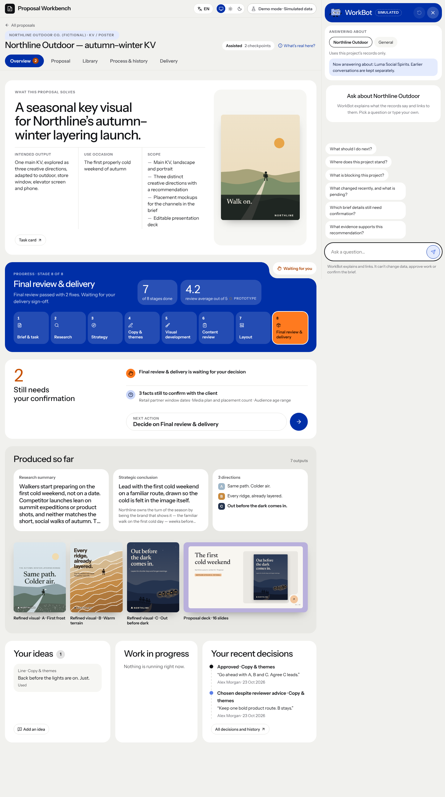

# 工作助手 · 页面开发规格

规范版本：1.0.1。页面ID：`assistant`。状态：部分要求已确认；完整页面待细化。负责人见[proposal-director](../agents/proposal-director.md)。

这是页面显示、状态与交互合同；业务做法由岗位和方法承担，页面实现不自行改变业务门禁。共同视觉规则见[桌面UI基线](../specs/ui-system.md)。

## 使用任务

解释当前项目、定位实际对象和页面。

## 范围

打开／收起，项目上下文与通用上下文分开；完整页面未另行定稿。桌面助手不混作阶段协作栏。

## 边界

解释和导航不暗改稿件或批准；游客不可用。会话和焦点保持，真实模型尚未接入。

## 已确认要求清单

- 桌面助手可打开和收起，解释当前项目并引导到实际对象。
- 区分项目和通用上下文，不能通过聊天暗改稿件或批准。
- 游客不能使用助手；旧手机助手布局已被中文桌面要求覆盖。

- 不与协作侧栏混成同一角色；原桌面会话和焦点保持。

## 本页验收与接入核对

- 解释、导航和业务写入分开。

### 本次接入快照

以下是2026-11-11核对时的实现信息，不是长期门槛；实际进度继续从[状态导航](../../status/current.md)和原生回执读取。后续状态变化不倒写此快照。

- 当前是本地演示，真实模型问答及权限接线不因界面存在而完成。

复验主阅读顺序、相关操作、长内容／错误状态、目标桌面与边界；按[UI审核岗位](../agents/ui-review-owner.md)记录实际范围。尚未接线的动作显示真实状态，不以示例按钮冒充能力。

## 可比对界面

旧八阶段演示 · 工作助手。既有界面留档，不证明所有现行要求已实现或获批。原图身份见[截图来源清单](../specs/screenshot-provenance.json)。

## 来源与版本

要求来源：现有[用户决定索引](../specs/decisions.md)、[版本沿革](../handoffs/提案工作台_版本沿革与已确认要求_20261111.md)及本次[来源清单](../specs/source-provenance.json)。图像是证据，不覆盖当前文字要求。新需求通过[变更与PR规则](../specs/change-control.md)更新本文件版本。
