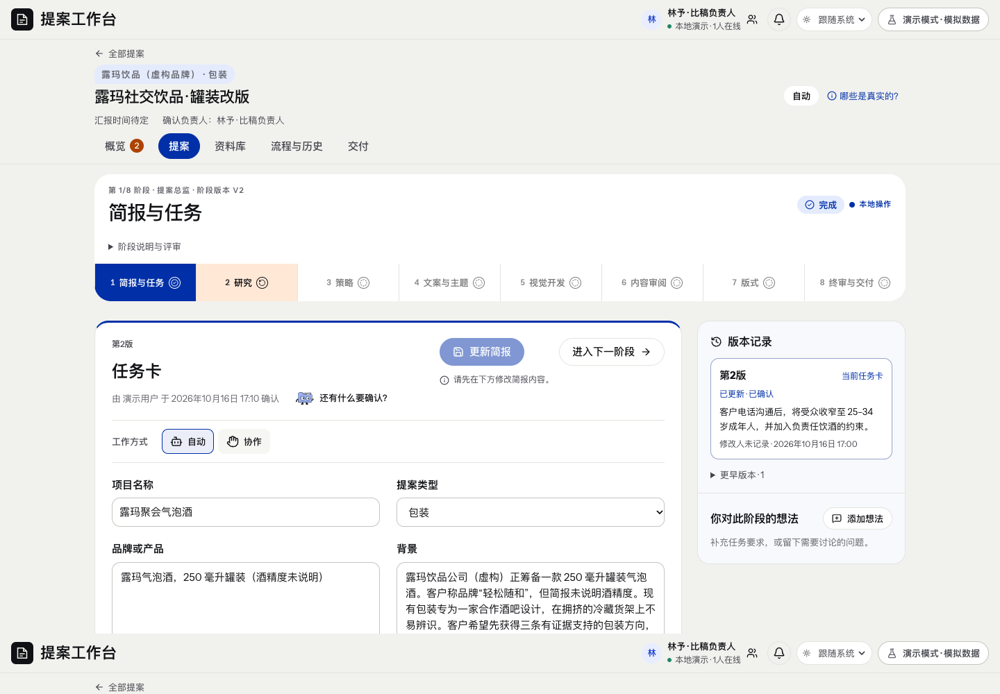

# 简报与任务 · 页面开发规格

规范版本：1.1.0。页面ID：`brief`。状态：已确认要求汇编；本次整理待核对。负责人见[brief-owner](../agents/brief-owner.md)。

这是页面显示、状态与交互合同；业务做法由岗位和方法承担，页面实现不自行改变业务门禁。共同视觉规则见[桌面UI基线](../specs/ui-system.md)。

## 使用任务

在一份当前卡里核对或直接更新需求，看到最近变化和协作意见。

## 主区

名称、类型、品牌或产品、背景、受众、交付内容；更多信息只放调研问题、限制条件与一份品牌参考资料。自动／协作用简洁图标。

## 右栏

阶段想法＋版本记录；每版有真实作者、备注和确认状态，意见已落实只有实际更新关联后才标记。

## 行为

当前卡内编辑。未确认显示确认简报，已确认显示更新简报；更新产生待确认新版本。进入下一阶段在首屏，属于导航。五行主输入、品牌与背景底边对齐，内部滚动、禁拖拽。

## 异常

保存冲突、未保存离开、同版查询回填、历史只读。保留旧隐藏字段和来源，不静默覆盖。

## 已确认要求清单

- 主字段为项目名称、提案类型、品牌或产品、背景、目标受众、交付内容。
- 更多信息仅保留调研问题、限制条件及一份品牌与参考资料；旧字段值保留。
- 自动和协作两种工作方式，使用简单图标；任务卡只有一份。
- 阶段想法和版本记录放右侧，每版有备注、真实修改人及确认状态。

- 项目任务页长文本框五行，品牌与背景框底边对齐，内部滚动，禁拖动。
- 未确认显示确认简报，已确认显示更新简报；在当前卡内修改。
- 进入下一阶段放首屏，只是导航，不伪造业务放行。

## 本页验收与接入核对

- 已确认内容修改先核影响并形成待确认新版。
- 保留预期修订号、冲突保护和历史只读；留言不自动冒称已落实。

### 本次接入快照

以下是2026-11-11核对时的实现信息，不是长期门槛；实际进度继续从[状态导航](../../status/current.md)和原生回执读取。后续状态变化不倒写此快照。

- 正式后端的类型、编辑范围与历史作者合同仍需对接。

复验主阅读顺序、相关操作、长内容／错误状态、目标桌面与边界；按[UI审核岗位](../agents/ui-review-owner.md)记录实际范围。尚未接线的动作显示真实状态，不以示例按钮冒充能力。

## 可比对界面

after.png。既有界面留档，不证明所有现行要求已实现或获批。原图身份见[截图来源清单](../specs/screenshot-provenance.json)。

## 来源与版本

要求来源：现有[用户决定索引](../specs/decisions.md)、[版本沿革](../handoffs/提案工作台_版本沿革与已确认要求_20261111.md)及本次[来源清单](../specs/source-provenance.json)。图像是证据，不覆盖当前文字要求。新需求通过[变更与PR规则](../specs/change-control.md)更新本文件版本。

## 当前HTTP接入边界

HTTP保存保留隐藏字段和来源，作者取原生local-operator；原生修订作乐观锁。未确认连续保存折叠为同一业务版本，确认后编辑形成待确认新版，全部原生快照保留。未决提交在发送前按接口与角色隔离持久化，刷新后显式核对；恢复期间锁定身份。刷新重试绑定原始修订与同一命令；历史重放被新稿替代时返回冲突。完整合同见[本地简报HTTP](../development/http-brief.md)。本轮简报范围实际UI见[核验](../development/http-brief-verification-20261111.md)，旧基线截图保留原身份。

## 当前品牌PDF原件

当前HTTP品牌原件可在既有更多信息/品牌资料区读取和下载，保存位置如实显示为当前项目，来源文本与独立原文件分开。当前卡未确认也能保存；卡改版不覆写原件或补采用。能力、同体恢复和逐字节核对见[原件合同](../development/brief-originals.md)。

## PDF本地解析副层

沿用原资料下载行与折叠信息，在实际HTTP能力存在时显示本地解析状态、显式解析/已失败本地重试和已保存分页正文。缺能力给真实原因；原件下载不依赖解析。历史原件只读，部分/无文字/加密/非法/限制与job状态分别显示；不自动采用为任务或研究。原请求丢响应按同body核回，真正未知保留待核。范围见[本地解析合同](../development/brief-extraction.md)，实际UI另按本轮证据记录，不改变旧固定截图身份。
