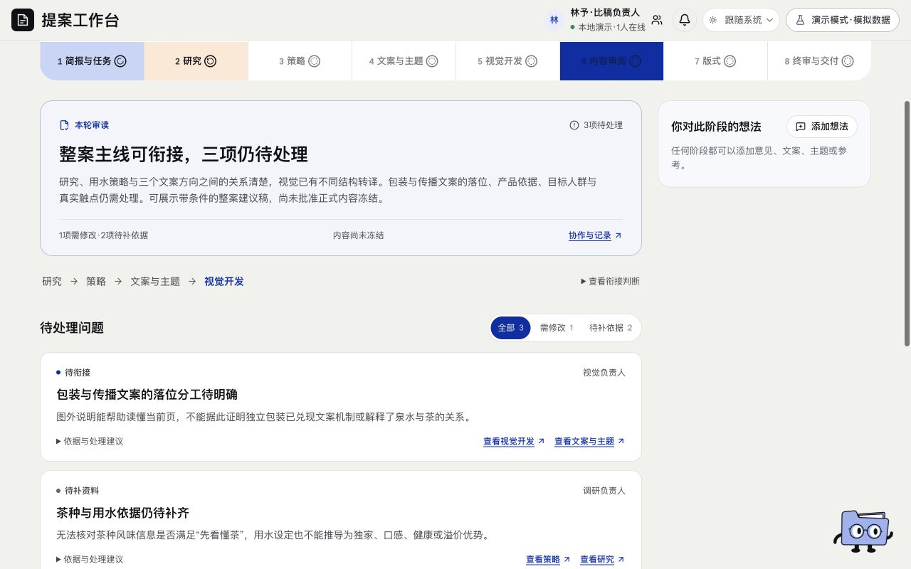

# 旧内容审阅 · 页面开发规格

规范版本：1.0.1。页面ID：`content_review`。状态：退役；保留历史。负责人见[proposal-director](../agents/proposal-director.md)。

这是页面显示、状态与交互合同；业务做法由岗位和方法承担，页面实现不自行改变业务门禁。共同视觉规则见[桌面UI基线](../specs/ui-system.md)。

## 状态

2026-11-11已取消独立环节和负责人，归入退役历史，当前七阶段导航不显示。

## 保留

旧正文、问题、评论、作者、状态与回执按原身份只读留存。

## 替代职责

比稿Agent逐阶段检查及排版前简短后台检查，排版后仍终审；删除页面不等于解决原问题。

## 已确认要求清单

- 比稿Agent逐阶段检查同一Brief、有效上游与逻辑承接。
- 排版前简短检查新增矛盾、版本失配和必要产物缺失。
- 已说明的演练限制随稿保留，不反复变成新的前台待办。

- 新流程视觉后直接排版，旧审阅URL转到排版。
- 旧审阅记录在历史中只读保留，不改为通过。

## 本页验收与接入核对

- 新的实质问题退回所属负责人；不能把退役节点自动标done来消除它。

### 本次接入快照

以下是2026-11-11核对时的实现信息，不是长期门槛；实际进度继续从[状态导航](../../status/current.md)和原生回执读取。后续状态变化不倒写此快照。

- 取消页面不等于关闭原三项问题、批准视觉或冻结正式内容。

复验主阅读顺序、相关操作、长内容／错误状态、目标桌面与边界；按[UI审核岗位](../agents/ui-review-owner.md)记录实际范围。尚未接线的动作显示真实状态，不以示例按钮冒充能力。

## 可比对界面

青屿旧内容审阅页，实际三项待处理。既有界面留档，不证明所有现行要求已实现或获批。原图身份见[截图来源清单](../specs/screenshot-provenance.json)。

## 来源与版本

要求来源：现有[用户决定索引](../specs/decisions.md)、[版本沿革](../handoffs/提案工作台_版本沿革与已确认要求_20261111.md)及本次[来源清单](../specs/source-provenance.json)。图像是证据，不覆盖当前文字要求。新需求通过[变更与PR规则](../specs/change-control.md)更新本文件版本。
