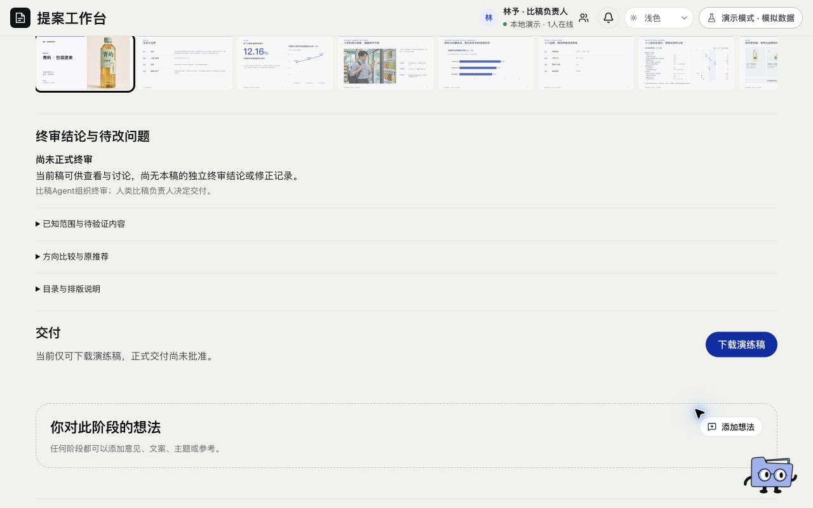

# 终审与交付 · 页面开发规格

规范版本：1.0.2。页面ID：`delivery`。状态：已确认要求汇编；本次整理待核对。负责人见[final-review-owner](../agents/final-review-owner.md)，业务按[终审协议](../specs/final-review.md)。

这是页面显示、状态与交互合同；业务做法由岗位和方法承担，页面实现不自行改变业务门禁。共同视觉规则见[桌面UI基线](../specs/ui-system.md)。

## 使用任务

先看成稿，再看终审问题与范围，最后处理交付。

## 当前实现顺序

成稿、终审摘要与待改、交付；比较和依据默认收起。青屿23页演练可预览，正式未终审必须显著说明。此顺序记录当前实现，不新增用户审美批准。

## 动作

翻页、目录、定位比较页、下载实际同版文件；人工确认在正文后，继续受角色、对象和版本约束。

## 状态

未有排版／有演练稿未终审／需修改／实际通过／交付受阻分开。按钮交给浏览器、文件已绑定、文件内容已核对分别记录。

## 已确认要求清单

- 审核排版后的实际页序、表达、完整性、重复、图文、来源与交付产物。
- 人类比稿负责人保留决定权，AI统筹不能代替独立裁判或人类批准。
- UI通过、下载成功或某阶段通过不等于全案终审批准。

- 保留七阶段中的终审与交付，不随独立内容审阅取消。
- 正式数据未有排版时显示等待版式；已授权的本地只读稿可独立预览和诊断，不回填正式layout或审批。
- 通用模板的比较、推荐及剩余限制按实际对象呈现；主层先成稿、再问题、后交付，详细依据和比较按需展开。

## 本页验收与接入核对

- 实际排版产物就绪，核对应版本与来源，独立审核和人类决定按权限执行。

### 本次接入快照

以下是2026-11-11核对时的实现信息，不是长期门槛；实际进度继续从[状态导航](../../status/current.md)和原生回执读取。后续状态变化不倒写此快照。

- 青屿23页本地诊断已完成并接入4417，五职责双路审读、对应质疑及独立裁定留档，7项建议可定位；正式状态和人类批准未写入。新下载已绑定核对，实际范围按当前原生回执核对。
- 在线PPT编辑及保存恢复继续暂缓。

复验主阅读顺序、相关操作、长内容／错误状态、目标桌面与边界；按[UI审核岗位](../agents/ui-review-owner.md)记录实际范围。尚未接线的动作显示真实状态，不以示例按钮冒充能力。

## 可比对界面

2026-11-11终审页当前实现：演练稿未正式终审。既有界面留档，不证明所有现行要求已实现或获批。原图身份见[截图来源清单](../specs/screenshot-provenance.json)。

## 来源与版本

要求来源：现有[用户决定索引](../specs/decisions.md)、[版本沿革](../handoffs/提案工作台_版本沿革与已确认要求_20261111.md)及本次[来源清单](../specs/source-provenance.json)。图像是证据，不覆盖当前文字要求。新需求通过[变更与PR规则](../specs/change-control.md)更新本文件版本。
