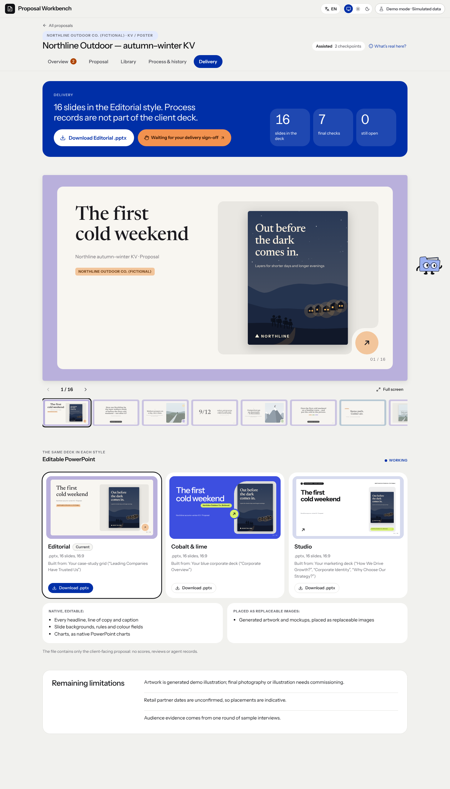

# 交付中心 · 页面开发规格

规范版本：1.0.1。页面ID：`delivery_center`。状态：部分要求已确认；完整页面待细化。负责人见[final-review-owner](../agents/final-review-owner.md)。

这是页面显示、状态与交互合同；业务做法由岗位和方法承担，页面实现不自行改变业务门禁。共同视觉规则见[桌面UI基线](../specs/ui-system.md)。

## 使用任务

从项目区域找到当前有效交付文件和范围。

## 区别

交付中心属于五项目区域，不是再加一个生产阶段；与第七阶段终审入口分开。完整独立页面仍未专项细化。

## 状态

演练、正式、已审、待审和文件缺失清楚区分；真实有效文件才能下载。内部过程与客户阅读稿分开。

## 已确认要求清单

- 这是项目五区域中的交付入口，与第七阶段的终审职责区分。
- 提供实际有效提案与可编辑PPTX下载，来源、原件及范围保留。
- 客户看到有效稿，内部历史、评分与过程另行收起。

- 下载成功不等于终审批准。
- 文字、图表和形状可编辑，图片内文字仍是像素。

## 本页验收与接入核对

- 交付必须关联实际产物和有效版本，不能用演示文件替代正式结果。

### 本次接入快照

以下是2026-11-11核对时的实现信息，不是长期门槛；实际进度继续从[状态导航](../../status/current.md)和原生回执读取。后续状态变化不倒写此快照。

- 青屿当前是只读排版预览，未写正式layout与交付状态。
- 在线PPT修改、保存恢复继续暂缓。

复验主阅读顺序、相关操作、长内容／错误状态、目标桌面与边界；按[UI审核岗位](../agents/ui-review-owner.md)记录实际范围。尚未接线的动作显示真实状态，不以示例按钮冒充能力。

## 可比对界面

旧八阶段演示 · 交付中心。既有界面留档，不证明所有现行要求已实现或获批。原图身份见[截图来源清单](../specs/screenshot-provenance.json)。

## 来源与版本

要求来源：现有[用户决定索引](../specs/decisions.md)、[版本沿革](../handoffs/提案工作台_版本沿革与已确认要求_20261111.md)及本次[来源清单](../specs/source-provenance.json)。图像是证据，不覆盖当前文字要求。新需求通过[变更与PR规则](../specs/change-control.md)更新本文件版本。
