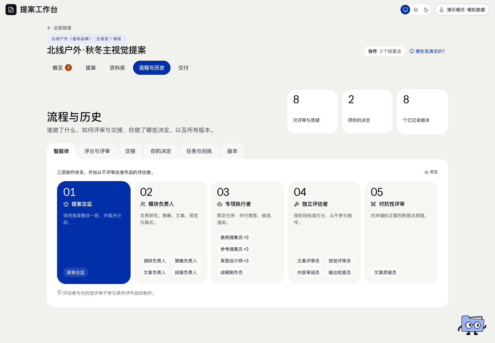

# 流程与历史 · 页面开发规格

规范版本：1.0.0。页面ID：`history`。状态：部分要求已确认；完整页面待细化。负责人见[proposal-director](../agents/proposal-director.md)。

这是页面显示、状态与交互合同；业务做法由岗位和方法承担，页面实现不自行改变业务门禁。共同视觉规则见[桌面UI基线](../specs/ui-system.md)。

## 使用任务

查清谁在什么版本改了什么、依据和意见是什么。

## 要求范围

版本、稿件、图片、评分、异议、修改、采用关系按真实发生顺序；当前和历史分开。页面完整交互仍待专项确认。

## 状态

失败、未知、历史、已验证范围分别显示；缺作者不补造，上游变化不沿用旧pass。旧内容审阅原件仍可追溯。

## 已确认要求清单

- 保留任务、稿件、原图、评分、异议、修改和采用关系。
- 原评与追加复核分别保存，不覆盖旧分。
- 独立内容审阅退役后，其旧正文、意见和回执仍只读保留。

- 当前有效、历史、失败和未知状态清楚区分。
- 旧记录缺少对象或作者时，不补造精确历史。

## 本页验收与接入限制

- 上游变化重核受影响内容，不能把旧通过套到新稿。

- 页面既有结构保留，本轮尚未逐项重新定稿其交互。

复验主阅读顺序、相关操作、长内容／错误状态、目标桌面与边界；按[UI审核岗位](../agents/ui-review-owner.md)记录实际范围。尚未接线的动作显示真实状态，不以示例按钮冒充能力。

## 可比对界面

process-agents.png。既有界面留档，不证明所有现行要求已实现或获批。原图身份见[截图来源清单](../specs/screenshot-provenance.json)。

## 来源与版本

要求来源：现有[用户决定索引](../specs/decisions.md)、[版本沿革](../handoffs/提案工作台_版本沿革与已确认要求_20261111.md)及本次[来源清单](../specs/source-provenance.json)。图像是证据，不覆盖当前文字要求。新需求通过[变更与PR规则](../specs/change-control.md)更新本文件版本。
