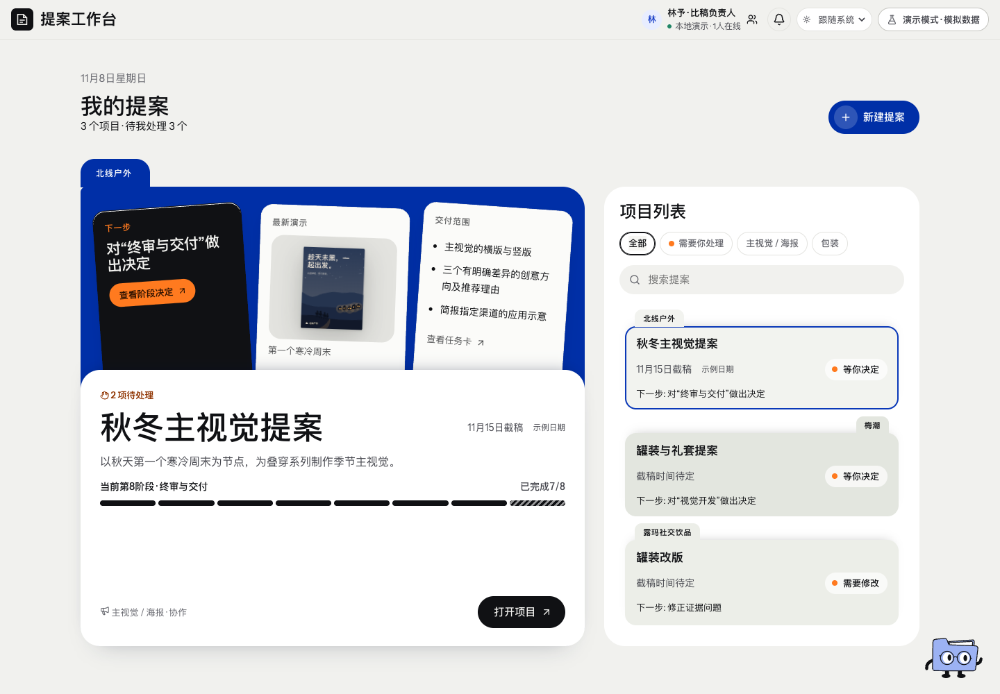

# 首页 · 页面开发规格

规范版本：1.0.1。页面ID：`home`。状态：已确认要求汇编；本次整理待核对。负责人见[ui-review-owner](../agents/ui-review-owner.md)。

这是页面显示、状态与交互合同；业务做法由岗位和方法承担，页面实现不自行改变业务门禁。共同视觉规则见[桌面UI基线](../specs/ui-system.md)。

## 使用任务

找到当前项目和接下来要处理的工作。

## 固定结构

左右布局；左蓝文件夹内三斜卡，右雾灰白项目列表与错落标签；对应主体上下边对齐。

## 内容与动作

项目简称、状态、下一步、截稿日期。创建按钮进入新建；卡片进入对应项目。显示日期而非倒计时，缺日期如实显示待定。

## 状态

已保存日期／待定；项目搜索或筛选有无结果；项目读取失败与无项目分开。

## 已确认要求清单

- 保留左右布局、左侧蓝色与B方案三张斜卡的边缘和阴影层次。
- 右侧选雾灰白，保留错落文件夹标签；标签使用项目简称。
- 右列表顶边对齐左文件夹标签下主体顶边，左右底边对齐。
- 只显示截稿日期，不显示剩余天数；时间在新建提案填写。

- 简化文字不等于删掉卡片层次和斜放版式。
- 首页不再提供日期填写入口，默认示例日期不是真实截止承诺。

## 本页验收与接入核对

- 每轮实际UI审核，保留原配色和信息层级。

### 本次接入快照

以下是2026-11-11核对时的实现信息，不是长期门槛；实际进度继续从[状态导航](../../status/current.md)和原生回执读取。后续状态变化不倒写此快照。

- 未找到首页专属业务Skill；已有明确页面要求与通用UI审核，不等于没有规范。

复验主阅读顺序、相关操作、长内容／错误状态、目标桌面与边界；按[UI审核岗位](../agents/ui-review-owner.md)记录实际范围。尚未接线的动作显示真实状态，不以示例按钮冒充能力。

## 可比对界面

after-1440.png。既有界面留档，不证明所有现行要求已实现或获批。原图身份见[截图来源清单](../specs/screenshot-provenance.json)。

## 来源与版本

要求来源：现有[用户决定索引](../specs/decisions.md)、[版本沿革](../handoffs/提案工作台_版本沿革与已确认要求_20261111.md)及本次[来源清单](../specs/source-provenance.json)。图像是证据，不覆盖当前文字要求。新需求通过[变更与PR规则](../specs/change-control.md)更新本文件版本。
