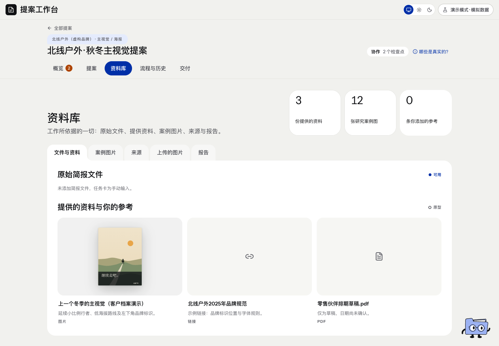

# 资料库 · 页面开发规格

规范版本：1.0.0。页面ID：`library`。状态：部分要求已确认；完整页面待细化。负责人见[brief-owner](../agents/brief-owner.md)。

这是页面显示、状态与交互合同；业务做法由岗位和方法承担，页面实现不自行改变业务门禁。共同视觉规则见[桌面UI基线](../specs/ui-system.md)。

## 使用任务

找到项目资料、品牌规范、原件和用途，供各阶段引用。

## 要求范围

这是已有资料合同的汇编，完整资料库交互尚未专项定稿。资料统一展示不多处重复，研究证据与美术借鉴区分。

## 状态

文件已保存、可下载、已被模型读取、已被采用分开；原图与来源可定位。正式存储和跨设备权限待接。

## 已确认要求清单

- 保留项目资料、品牌规范、原图、链接及用途。
- 研究证据和纯美术参考分开；原件和来源可追溯。
- 用户参考库可复用，Eagle不是强制依赖或自动审美真值。

- 资料不在多处重复堆叠；从统一入口查看原文和原件。

## 本页验收与接入限制

- 资料已上传、模型已读取、规范已采用分别记录。

- 本轮长对话未单独精修资料库完整页面；正式资源存储和权限仍待接。

复验主阅读顺序、相关操作、长内容／错误状态、目标桌面与边界；按[UI审核岗位](../agents/ui-review-owner.md)记录实际范围。尚未接线的动作显示真实状态，不以示例按钮冒充能力。

## 可比对界面

library-materials.png。既有界面留档，不证明所有现行要求已实现或获批。原图身份见[截图来源清单](../specs/screenshot-provenance.json)。

## 来源与版本

要求来源：现有[用户决定索引](../specs/decisions.md)、[版本沿革](../handoffs/提案工作台_版本沿革与已确认要求_20261111.md)及本次[来源清单](../specs/source-provenance.json)。图像是证据，不覆盖当前文字要求。新需求通过[变更与PR规则](../specs/change-control.md)更新本文件版本。
