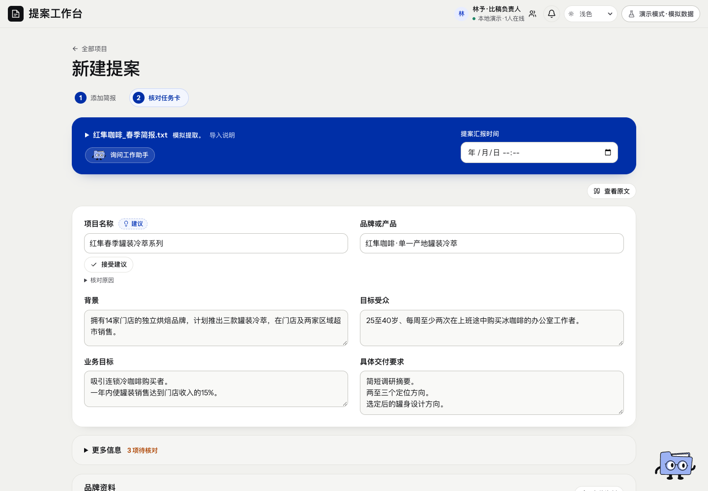

# 新建提案 · 页面开发规格

规范版本：1.0.0。页面ID：`new`。状态：已确认要求汇编；本次整理待核对。负责人见[brief-owner](../agents/brief-owner.md)。

这是页面显示、状态与交互合同；业务做法由岗位和方法承担，页面实现不自行改变业务门禁。共同视觉规则见[桌面UI基线](../specs/ui-system.md)。

## 使用任务

提交原Brief、核对可编辑任务卡、补充品牌资料，再创建项目。

## 固定结构

Brief输入与单份核对任务卡；蓝色与雾灰白呼应。提案类型紧随名称，六主字段与项目内保持一致。

## 表单行为

长输入三行等高、禁拖拽，超出内部滚动。汇报时间独立输入且可留空；品牌手册、格式规范、参考资料集中上传，不重复标题或来源说明。

## 状态与异常

解析中／待核对／保存中／冲突／失败有不同反馈；失败保留输入与文件选择，创建部分成功按真实回执接续，不能重复创建。

## 已确认要求清单

- 支持输入或上传Brief、核对任务卡及上传品牌手册和参考资料。
- 增加提案汇报时间；去掉选填等冗余说明，当前仍可留空。
- 核对任务卡标题不重复，普通字段不堆来源与说明，原文集中查看。
- 与首页蓝色和雾灰白呼应，长文本框默认三行等高、内部滚动、禁拖拽。

- 六个任务卡主字段与后续页面一致；提案类型紧随项目名称。
- 品牌资料原件保存不代表后续模型已经读取和应用。

## 本页验收与接入限制

- 类型、内容和版本同次保存；不从旧资料猜历史作者。

- 正式上传、跨设备存储及模型读取用途仍需接线。

复验主阅读顺序、相关操作、长内容／错误状态、目标桌面与边界；按[UI审核岗位](../agents/ui-review-owner.md)记录实际范围。尚未接线的动作显示真实状态，不以示例按钮冒充能力。

## 可比对界面

final-preview.png。既有界面留档，不证明所有现行要求已实现或获批。原图身份见[截图来源清单](../specs/screenshot-provenance.json)。

## 来源与版本

要求来源：现有[用户决定索引](../specs/decisions.md)、[版本沿革](../handoffs/提案工作台_版本沿革与已确认要求_20261111.md)及本次[来源清单](../specs/source-provenance.json)。图像是证据，不覆盖当前文字要求。新需求通过[变更与PR规则](../specs/change-control.md)更新本文件版本。
