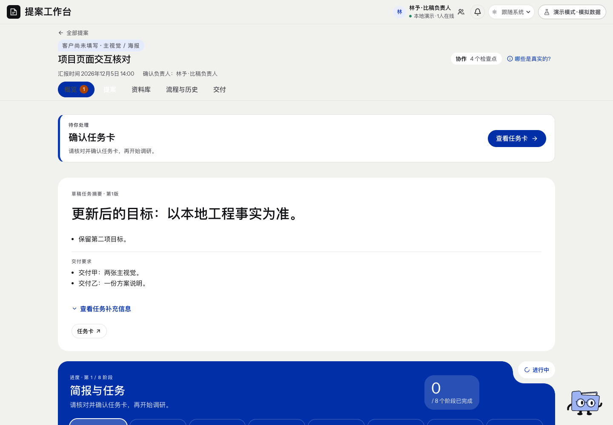

# 项目概览 · 页面开发规格

规范版本：1.0.1。页面ID：`overview`。状态：已确认要求汇编；本次整理待核对。负责人见[proposal-director](../agents/proposal-director.md)。

这是页面显示、状态与交互合同；业务做法由岗位和方法承担，页面实现不自行改变业务门禁。共同视觉规则见[桌面UI基线](../specs/ui-system.md)。

## 使用任务

一眼知道项目是什么、谁确认、何时汇报、现在该做什么。

## 固定结构

首屏项目摘要、汇报时间、确认负责人、模式和需要处理的确认入口；五项目区域与七阶段导航保留。

## 数据一致性

摘要来自成功保存的当前任务卡；字段被清空后不回退成旧摘要。只在确实没有当前卡时使用旧提案摘要，并显示状态。

## 状态

草稿／待确认／已确认与下一步分开；本地演练作品不改变正式阶段进度。

## 已确认要求清单

- 摘要来自实际已保存内容，显示汇报时间、确认负责人和工作方式。
- 先显示使用者当前要处理的对象，确认入口在首屏，不重复任务卡。
- 五个项目区域保留，阶段计数使用当前七阶段。
- 阶段状态、待办与提案内容的读取范围保持一致。

- 真实工作、演练内容与生成作品标记清楚。
- 进度比例和封面预览不能代替正式业务完成。

## 本页验收与接入核对

- 人类决定权不由AI推荐替代。

### 本次接入快照

以下是2026-11-11核对时的实现信息，不是长期门槛；实际进度继续从[状态导航](../../status/current.md)和原生回执读取。后续状态变化不倒写此快照。

- 通用后台进度和实际完成事件尚未全链路接通。

复验主阅读顺序、相关操作、长内容／错误状态、目标桌面与边界；按[UI审核岗位](../agents/ui-review-owner.md)记录实际范围。尚未接线的动作显示真实状态，不以示例按钮冒充能力。

## 可比对界面

final-overview.png。既有界面留档，不证明所有现行要求已实现或获批。原图身份见[截图来源清单](../specs/screenshot-provenance.json)。

## 来源与版本

要求来源：现有[用户决定索引](../specs/decisions.md)、[版本沿革](../handoffs/提案工作台_版本沿革与已确认要求_20261111.md)及本次[来源清单](../specs/source-provenance.json)。图像是证据，不覆盖当前文字要求。新需求通过[变更与PR规则](../specs/change-control.md)更新本文件版本。
