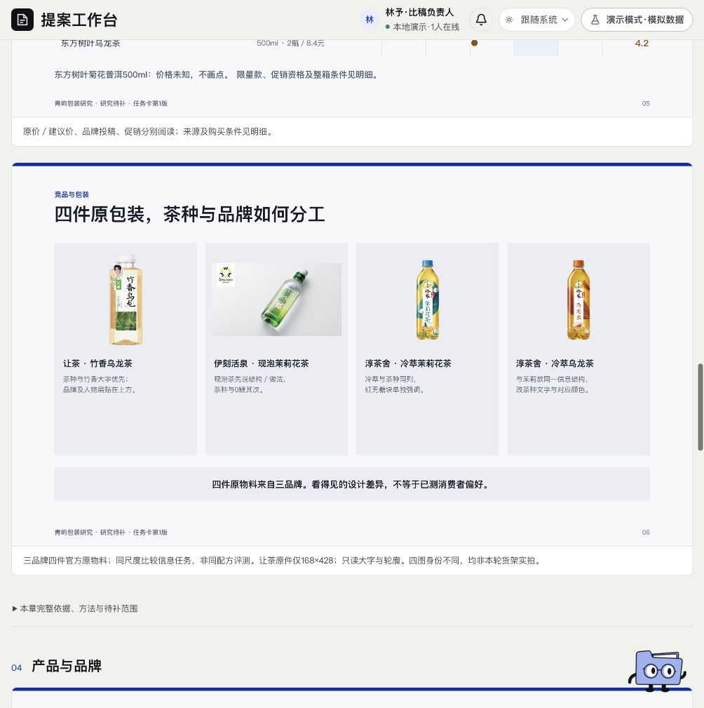

# 研究 · 页面开发规格

规范版本：1.8.0。页面ID：`research`。状态：已确认要求汇编；本次整理待核对。负责人见[research-owner](../agents/research-owner.md)。

这是页面显示、状态与交互合同；业务做法由岗位和方法承担，页面实现不自行改变业务门禁。共同视觉规则见[桌面UI基线](../specs/ui-system.md)。

## 使用任务

不熟悉品类的人也能看懂市场、消费者、竞品和产品条件，得到有依据的研究结论。

## 夜航项目的研究交接

研究方式来自项目入口。全自动模式显示自动调研进度和定向补查结果。协作模式先展示首轮取证，确实需要用户决定时，研究页显示一个会改变研究方向的问题。用户可以答复，也可以表示暂不确定，让研究按条件比较。两种模式对可自行解决的证据缺口使用相同的补查和交接要求，每次发起最多自主定向补查一轮。页面显示本轮是否足以交给策略，仍缺关键证据时留在研究。

夜航详情按本轮研究交接结果安排正文。

- **有可交接结论时**，只展示本轮已取证底稿上精选出的发现，按行业、竞品、用户顺序分组。行业栏呈现品类销售、格局与价格带；竞品栏呈现具体 SKU 的规格售价、包装或 KV 可见差异；用户栏呈现购买渠道、使用场景或偏好。各组优先两至三条不同角度。补查后仍不足，在对应组写明尚缺的角度和具体原因，保留已核内容。能在已知条件下交接时可照常进入策略；会改变策略取舍的关键缺口在待补查状态显示。每条展示短标题及支撑它的数据或具体解释。有数字时保留时间、范围、单位和口径；限定写到理解这条判断所必需的程度。每条可展开对应依据和来源。有网页出处时点「打开网页」；来源与本项目唯一同名上传附件匹配时，点「下载附件」核对原件。逐条策略用途、完整范围和核验过程留在研究底稿。未形成精选的历史稿可打开研究底稿与原图查看。旧稿若停在研究且已可交接，可点「从现有底稿编辑摘要」。
- **待补查时**，正文按问题列出影响策略的未知项，紧接「为什么要查」，说清答案会影响哪项判断。已精选的初步发现、来源和对应图版放在默认收起的线索区。查证理由取本轮记录，无法对应到问题的材料保留在原稿。无精选时，已核文字线索及原图仍可在底稿展开查看。重复的问题、状态说明和执行过程收进原稿或执行记录。
- **没有本轮研究记录时**，显示实际阶段状态。有旧报告可从原稿查看，交接结论依照本轮记录。

专项验收时分别查看有结论和待补查的同版项目，核对首屏信息顺序、各项展开后的来源、已有线索的默认折叠状态及原稿入口。

研究已取证且摘要编辑失败时，提供「重新编辑摘要」，从已核底稿继续。专项只跑研究时，通过后停在结果页，并提供「进入策略」。普通整链沿原流程自动继续。支持策略时进入策略阶段。策略审读后如仍缺足以作判断的证据，项目回到研究，页面显示退回原因。检索失败或证据不足时留在研究，说明原因，允许用户补充重点、再次查询。旧项目从研究重新开始时沿用原 Brief 和任务卡，旧版研究及下游文件归入历史，新一轮重新交接。旧稿没有同版证据记录时，页面按历史资料显示。

## 研究底稿的五板块

行业与市场、人群、竞品分析、产品与品牌、研究结论。包装、KV、TVC等按任务回答载体作用，页面不堆方法论。

## 图版

每板块结论先行；同口径趋势、价格点阵、人群情景、竞品多物料同屏和关系图按需选用。场景可生成但标示意；包装本体清楚放大，具体案例不替代整体比较。

包装与 KV 的竞品发现沿用编号列表，正文写本组可见差异的短标题和具体解释。展开依据时并排展示当次分析使用的竞品原图，每张对应自己的图名、可见观察和来源页。图片保持原比例、可点开看大图；待补查时同组图和观察收在已有线索中。未形成精选的旧报告及已有图版保留在底稿入口。

## 展开与下载

来源、条件、详细分析和核验收起。去掉逐图下载，底部单一调研报告下载。图表保留数据、单位、形状与后续PPT编辑结构。

## 状态

已有结论／研究待补／历史报告／查询错误分开。缺数据不画0，不给未经支持的完整结论；重新排版不改原方法身份。

## 已确认要求清单

- 从任务目的与载体作用定义问题，以行业与市场、人群、竞争、产品与品牌四维取证，末块综合为研究结论。
- 行业区分需求增长与供给增加；人群先是谁、生活与偏好，再连接包装/媒介作用。
- 竞品先整体地图和可比组，再清晰案例原图与共性/差异；不能只有一张张品牌图。
- 中国任务以适用中国资料支撑偏好；海外和邻近品类只作有边界的参照。
- 直接结论先行，事实/分析/任务设定分开，策略定位与具体创意留给下一阶段。

- 底稿保留行业与市场、人群、竞品、产品与载体作用、研究结论；夜航正文按行业、竞品、用户顺序展示本轮精选。
- 图表和原图为主，一章可多图；多包装同屏、历史价格点阵及人群情景按问题选择。
- 详细分析、方法、核验和完整来源点击展开；底部只保留一个整报告下载。
- 原生图表、文字、形状与图片分离，不能用整张PNG假称可编辑。

## 本页验收与接入核对

- 实际来源、指标口径、图像身份及推理需独立核验；读者理解回环不代替事实核验。
- 定向补查仍缺关键本地依据时，交已有发现和缺口，停在研究待补，不伪造释放。

### 本次接入快照

以下是2026-11-11核对时的实现信息，不是长期门槛；实际进度继续从[状态导航](../../status/current.md)和原生回执读取。后续状态变化不倒写此快照。

- 青屿当前仍研究待补；r7增加输出模板并不代表重搜市场。
- 研究图版与后续整案已在样本复用，任意Brief自动调研及正式模型/API仍待接。

复验主阅读顺序、相关操作、长内容／错误状态、目标桌面与边界；按[UI审核岗位](../agents/ui-review-owner.md)记录实际范围。尚未接线的动作显示真实状态，不以示例按钮冒充能力。

## 可比对界面

当前默认图版中的四件包装同屏，截图为研究界面。既有界面留档，不证明所有现行要求已实现或获批。原图身份见[截图来源清单](../specs/screenshot-provenance.json)。

## 来源与版本

要求来源：现有[用户决定索引](../specs/decisions.md)、[版本沿革](../handoffs/提案工作台_版本沿革与已确认要求_20261111.md)及本次[来源清单](../specs/source-provenance.json)。图像是证据，不覆盖当前文字要求。新需求通过[变更与PR规则](../specs/change-control.md)更新本文件版本。

## 当前HTTP接入

新协议项目用当前r7研究入口显示固定方法、实际原稿／来源和五板块空态，沿用现有配色和组件；默认执行关闭，原因可见，生成按钮禁用。原件按artifactId、contentHash和原始正文SHA核验。独立正文阅读、实际修订、逐项处理和复查放在折叠副层；缺证仍待补，报告保存不等于完成。旧演示与青屿投影保持各自身份。具体见[接续](../development/seven-stage-research.md)。

## 独立读者与修订操作

沿现有研究主图版、配色和组件，折叠显示问题预登记、独立席位与原报告。原报告含六维复述、逐题问答、跨维约束、具体问题、复查和限制；正文依据按需展开，不代替事实核验。

有需处理问题时，可通过既有修订引擎生成新版，再逐项记录处理和回应。依据选择来自已核SHA的新稿原段落，不要求用户输入JSON路径。保存回应与发起独立复查是两步；未解决问题与缺证不能因保存成功变成通过。

当前/历史报告、修订中/未完成、已保存处理、复查未决和实际原件错误分别显示。响应丢失保留同body恢复；已核历史结果明确提示历史并保留原问题或回应；首读、修订和核回操作的原折叠详情保留可复制的实际原请求及原版本身份。默认未配置不调用模型，Mock无此运行面板，旧青屿页面及原批准身份保持。接口与权限见[读者合同](../development/research-reader.md)，真实UI范围见[核验](../development/research-reader-verification-20261111.md)。

## 自动采集操作与状态

当前HTTP研究页沿主操作位置提供**采集并生成研究**或**继续本次研究**。来源与PDF选择、四分支覆盖/限制、原件状态与原结果核对收进**资料选择、四分支状态与原结果**。沿用现有中文桌面组件与图版，不改青屿及Mock身份；采集缺能力时保留按既有配置使用已登记来源的生成动作。

单次明确操作最多六个固定任务集合的step，只有本步全部实际成功才继续。刷新不自动续跑；冲突、原件错误和unknown停止。传输返回未知保留同body日志，原生结果未知另显示待核，不能因HTTP已知而绿灯通过。历史研究生成结果核回禁用并说明范围，游客不能执行或恢复写操作。

选入PDF需当前卡、实际bridge原件、已核抽取与`materialsRootShared`资格；partial正文可用但限制随资料保留。空来源可自动取证。研究稿保存后仍需事实核验、独立读者和交接。详细字段见[采集合同](../development/research-acquisition.md)，实际UI及独立复核按本轮证据另记。

当前采集的资料复选框回显原请求冻结的选择；刷新后仍按原集合显示并锁定。四分支先显示原记录的摘录与来源站点数量，完整范围和限制原文保留在二级原始记录中；数量不代表覆盖充分或适用性通过。
