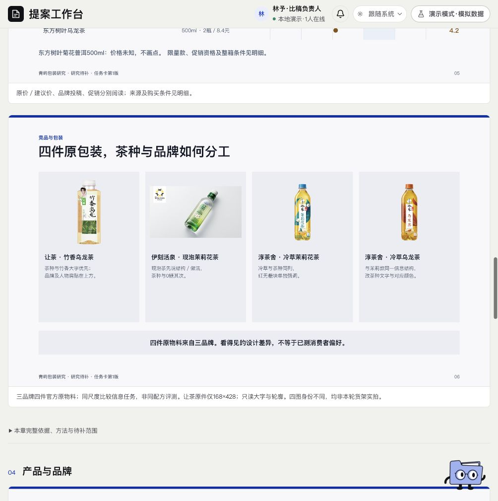

# 研究 · 页面开发规格

规范版本：1.1.0。页面ID：`research`。状态：已确认要求汇编；本次整理待核对。负责人见[research-owner](../agents/research-owner.md)。

这是页面显示、状态与交互合同；业务做法由岗位和方法承担，页面实现不自行改变业务门禁。共同视觉规则见[桌面UI基线](../specs/ui-system.md)。

## 使用任务

不熟悉品类的人也能看懂市场、消费者、竞品和产品条件，得到有依据的研究结论。

## 五板块

行业与市场、人群、竞品分析、产品与品牌、研究结论。包装、KV、TVC等按任务回答载体作用，页面不堆方法论。

## 图版

每板块结论先行；同口径趋势、价格点阵、人群情景、竞品多物料同屏和关系图按需选用。场景可生成但标示意；包装本体清楚放大，具体案例不替代整体比较。

## 展开与下载

来源、条件、详细分析和核验收起。去掉逐图下载，底部单一调研报告下载。图表保留数据、单位、形状与后续PPT编辑结构。

## 状态

已有结论／研究待补／历史报告／查询错误分开。缺数据不画0，不给未经支持的完整结论；重新排版不改原方法身份。

## 已确认要求清单

- 从任务目的与载体作用定义问题，以行业与市场、人群、竞争、产品与品牌四维取证，末块综合为研究结论。
- 行业区分需求增长与供给增加；人群先是谁、生活与偏好，再连接包装/媒介作用。
- 竞品先整体地图和可比组，再清晰案例原图与共性/差异；不能只有一张张品牌图。
- 中国任务以适用中国资料支撑偏好；海外和邻近品类只作有边界的参照。
- 直接结论先行，事实/分析/任务设定分开，策略定位与具体创意留给下一阶段。

- 五章呈现行业与市场、人群、竞品、产品与载体作用、研究结论。
- 图表和原图为主，一章可多图；多包装同屏、历史价格点阵及人群情景按问题选择。
- 详细分析、方法、核验和完整来源点击展开；底部只保留一个整报告下载。
- 原生图表、文字、形状与图片分离，不能用整张PNG假称可编辑。

## 本页验收与接入核对

- 实际来源、指标口径、图像身份及推理需独立核验；读者理解回环不代替事实核验。
- 定向补查仍缺关键本地依据时，交已有发现和缺口，停在研究待补，不伪造释放。

### 本次接入快照

以下是2026-11-11核对时的实现信息，不是长期门槛；实际进度继续从[状态导航](../../status/current.md)和原生回执读取。后续状态变化不倒写此快照。

- 青屿当前仍研究待补；r7增加输出模板并不代表重搜市场。
- 研究图版与后续整案已在样本复用，任意Brief自动调研及正式模型/API仍待接。

复验主阅读顺序、相关操作、长内容／错误状态、目标桌面与边界；按[UI审核岗位](../agents/ui-review-owner.md)记录实际范围。尚未接线的动作显示真实状态，不以示例按钮冒充能力。

## 可比对界面

当前默认图版中的四件包装同屏，截图为研究界面。既有界面留档，不证明所有现行要求已实现或获批。原图身份见[截图来源清单](../specs/screenshot-provenance.json)。

## 来源与版本

要求来源：现有[用户决定索引](../specs/decisions.md)、[版本沿革](../handoffs/提案工作台_版本沿革与已确认要求_20261111.md)及本次[来源清单](../specs/source-provenance.json)。图像是证据，不覆盖当前文字要求。新需求通过[变更与PR规则](../specs/change-control.md)更新本文件版本。

## 当前HTTP接入

新协议项目用当前r7研究入口显示固定方法、实际原稿／来源和五板块空态，沿用现有配色和组件；默认执行关闭，原因可见，生成按钮禁用。原件按artifactId、contentHash和原始正文SHA核验。独立正文阅读、实际修订、逐项处理和复查放在折叠副层；缺证仍待补，报告保存不等于完成。旧演示与青屿投影保持各自身份。具体见[接续](../development/seven-stage-research.md)。

## 独立读者与修订操作

沿现有研究主图版、配色和组件，折叠显示问题预登记、独立席位与原报告。原报告含六维复述、逐题问答、跨维约束、具体问题、复查和限制；正文依据按需展开，不代替事实核验。

有需处理问题时，可通过既有修订引擎生成新版，再逐项记录处理和回应。依据选择来自已核SHA的新稿原段落，不要求用户输入JSON路径。保存回应与发起独立复查是两步；未解决问题与缺证不能因保存成功变成通过。

当前/历史报告、修订中/未完成、已保存处理、复查未决和实际原件错误分别显示。响应丢失保留同body恢复；已核历史结果明确提示历史并保留原问题或回应。默认未配置不调用模型，Mock无此运行面板，旧青屿页面及原批准身份保持。接口与权限见[读者合同](../development/research-reader.md)，真实UI范围见[核验](../development/research-reader-verification-20261111.md)。
