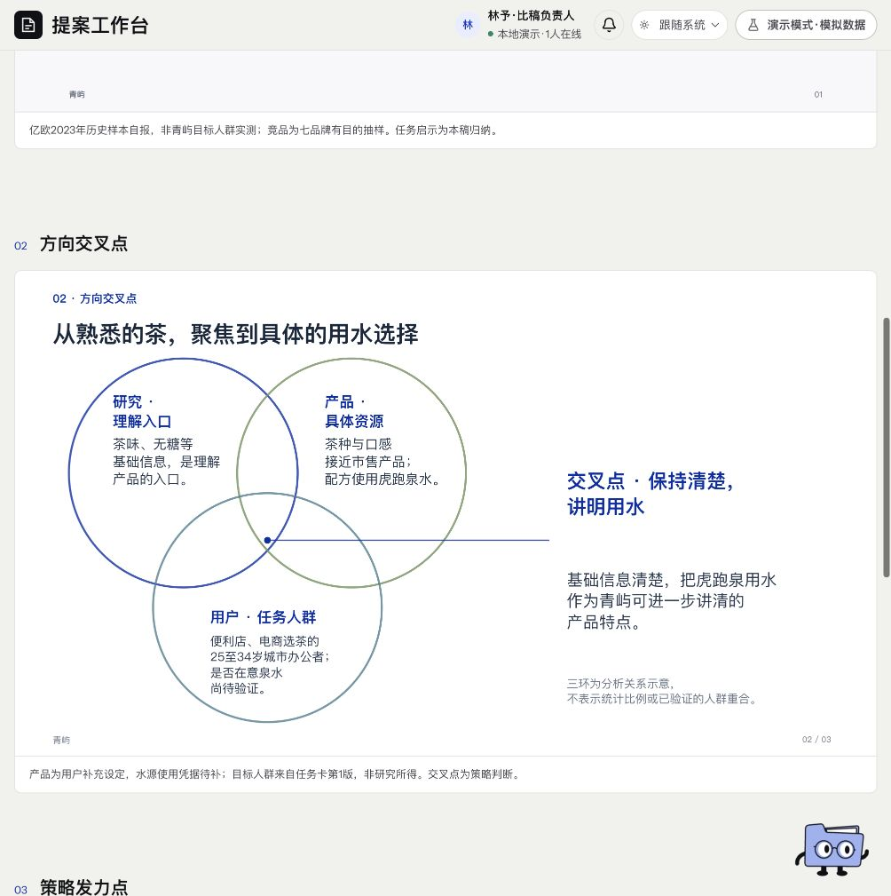

# 策略 · 页面开发规格

规范版本：1.5.0。页面ID：`strategy`。状态：已确认要求汇编；本次整理待核对。负责人见[strategy-owner](../agents/strategy-owner.md)。

这是页面显示、状态与交互合同；业务做法由岗位和方法承担，页面实现不自行改变业务门禁。共同视觉规则见[桌面UI基线](../specs/ui-system.md)。

## 使用任务

快速理解研究、产品、用户如何收拢为值得发力的方向。

## 夜航一页策略

包装、KV 及联动的一页策略先以夜航大字呈现一句核心策略。下方四节固定为两行两列，按行阅读：第一行左「人群洞察」、右「品牌角色」，第二行左「核心主张」、右「视觉与包装触点」。三个动作跟随主张；包装对应正侧背，KV 对应实际媒介，联动同时覆盖。三项待测指标、观察方法和场景仅留在后台原稿。

| 元素 | 夜航原版样式 |
| --- | --- |
| 核心策略大字句（statement） | 字号 `clamp(24px, 3vw, 34px)`，字重 700，行高 1.5，最大宽度 22em，段后间距 26px |
| 章节标题（h2） | 21px，字重 700 |
| 四节小标题（h3） | 衬线字体，17px，字重 700，行高 1.5，下方间距 4px |
| 四节正文 | 15px，字重 400，行高 1.7 |
| 双栏 | 两列等宽，单列最小 300px，列距 44px。宽度不足时沿夜航断点依阅读顺序换行 |
| 分节 | 上方细线，区块上内距 16px、下内距 18px。使用同一文档底色，无卡片 |

验收时用实际长短稿核对四节次序、标题与正文基线及换行。更换项目、方向或文字长度时复用同一布局。

原稿保留价格带与渠道等约束、禁用声称、竞品资源与空隙、决策链、取舍优先级和研究出处。客户可展开查看依据。遇到研究待补直接进入本案待查问题。判定是否使用新版以实际出稿合同为准；查看旧项目不触发重新生成。

## 其他载体、历史稿与经典三板块

研究结论、方向交叉点、策略发力点；两三页，以原生三环交集和右侧结论等策略布局呈现。

## 三板块稿的阅读顺序

首屏先用一句话说明优先放大哪个产品特质。其下左栏逐条列出研究结论，每条可展开对应的依据、出处与适用范围。右栏用研究、产品、人群三项说明为什么选择这个方向。原稿折叠保留；旧稿缺依据时保留原有内容。

研究仍待补查时，策略页只显示一句状态和「查看待查问题」，点击返回本项目研究页。青屿策略演练稿可单独只读查看，保留其原始身份，不写入业务交接。

## 边界

只给解决方向和优先放大的特质，不提前写主副文、具体场景口号或做画面；不把开瓶即饮等品类共性冒称差异。

## 状态

依据足够／条件性建议／关键依据待补分别呈现；旧被退回策略保留历史，不作为当前推荐。

## 已确认要求清单

- 依据研究，结合真实产品特质与目标用户，找到能回应任务的交叉点。
- 说明优先放大什么、为什么，缺关键依据就地标明。
- 具体主题、主副文与创意画面留给后续，不在策略页提前写完。

- 对三板块稿使用两三页、三个板块：研究结论、方向交叉点、策略发力点。
- 沿用研究版式体系，第二页三环交集引线接右侧结论，首末页不随机换样式。
- 三环是分析关系示意，不表示统计面积或已验证人群重合。

## 本页验收与接入核对

- 研究支持判断、产品确具特质、与用户相关、方向清楚。
- 不以“能直接喝茶”等全品类通用事实充当品牌差异化。

### 本次接入快照

以下是2026-11-11核对时的实现信息，不是长期门槛；实际进度继续从[状态导航](../../status/current.md)和原生回执读取。后续状态变化不倒写此快照。

- 虎跑泉用水是用户演练设定；来源、比例、消费者效果未被此策略证明。
- 原策略Skill与评审是历史材料，不能因目录仍在就恢复强制调用。

复验主阅读顺序、相关操作、长内容／错误状态、目标桌面与边界；按[UI审核岗位](../agents/ui-review-owner.md)记录实际范围。尚未接线的动作显示真实状态，不以示例按钮冒充能力。

## 可比对界面

三板块版策略的三环交集与右侧结论。既有界面留档，不证明所有现行要求已实现或获批。原图身份见[截图来源清单](../specs/screenshot-provenance.json)。

## 来源与版本

要求来源：现有[用户决定索引](../specs/decisions.md)、[版本沿革](../handoffs/提案工作台_版本沿革与已确认要求_20261111.md)及本次[来源清单](../specs/source-provenance.json)。图像是证据，不覆盖当前文字要求。新需求通过[变更与PR规则](../specs/change-control.md)更新本文件版本。

## 当前HTTP三板块工作区

当前HTTP策略页以可选simpleStrategy能力读取实际SIMPLE合同稿件，沿既有三板块与三环加右侧结论结构。逐点显示事实、任务要求、推论或假设、引用及限制；原稿与SHA、全文核验和历史身份折叠。三环只说明产品、人群、竞争关系，不表示统计面积或已验证人群重合。Mock及青屿原样保持身份。

未配置、默认research授权、研究未放行、历史及原件错误均显示原因。只有当前研究全部前置、原release与显式创建授权成立，才允许策略页明确生成。导航只读，不自动生成；游客不能执行或恢复写操作。报告保存保持待核验/待接收，原生`needs_acceptance`不表示stage complete或客户批准。

原body待核、native unknown和已核历史分别呈现。策略及核验原结果只恢复仍当前的已保存IO，历史或缺IO不重派。策略双负责人到copy已按受限接口接线，策略修订仍待接，不能以保存按钮签通过。接口、创建授权及原件边界见[简洁策略运行合同](../development/simple-strategy.md)。实际UI范围另按原生核验记录登记。

## 显式交给文案负责人

当前已核SIMPLE可在本页提交双方负责人接收，后续按当前工作阶段继续交接与文案生产。双方原报告保留在详情，不由保存稿件或导航自动生成接受。

若项目要求strategy人工节点，先显示**人工采用当前策略**。具有`decide/strategy`权限的人填写理由，明确采用已核同版artifact及SHA后才可继续。该记录调用原生adopt-creative，不是release-stage，不表示客户批准。游客只读。当前文案接续及unknown边界见[文案运行合同](../development/simple-copy.md)。
