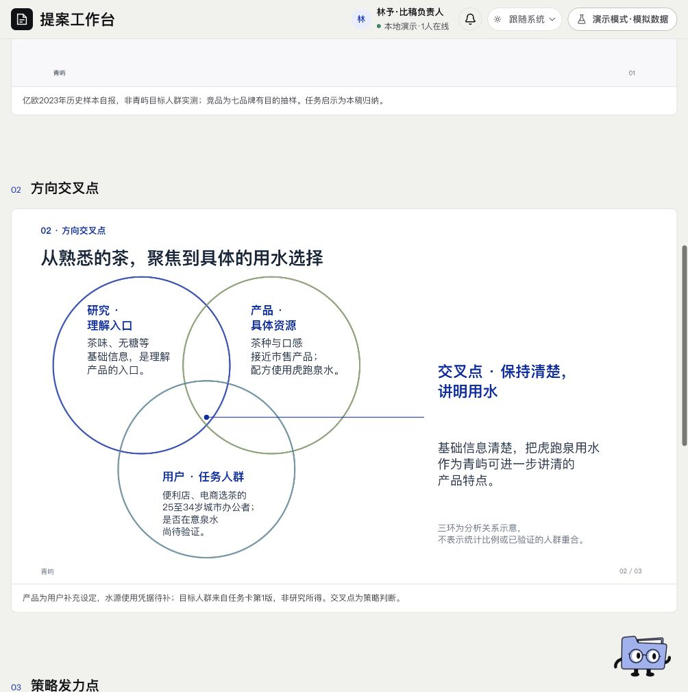

# 策略 · 页面开发规格

规范版本：1.0.0。页面ID：`strategy`。状态：已确认要求汇编；本次整理待核对。负责人见[strategy-owner](../agents/strategy-owner.md)。

这是页面显示、状态与交互合同；业务做法由岗位和方法承担，页面实现不自行改变业务门禁。共同视觉规则见[桌面UI基线](../specs/ui-system.md)。

## 使用任务

快速理解研究、产品、用户如何收拢为值得发力的方向。

## 三板块

研究结论、方向交叉点、策略发力点；两三页，以原生三环交集和右侧结论等策略布局呈现。

## 边界

只给解决方向和优先放大的特质，不提前写主副文、具体场景口号或做画面；不把开瓶即饮等品类共性冒称差异。

## 状态

依据足够／条件性建议／关键依据待补分别呈现；旧被退回策略保留历史，不作为当前推荐。

## 已确认要求清单

- 依据研究，结合真实产品特质与目标用户，找到能回应任务的交叉点。
- 说明优先放大什么、为什么，缺关键依据就地标明。
- 具体主题、主副文与创意画面留给后续，不在策略页提前写完。

- 两三页、三个板块：研究结论、方向交叉点、策略发力点。
- 沿用研究版式体系，第二页三环交集引线接右侧结论，首末页不随机换样式。
- 三环是分析关系示意，不表示统计面积或已验证人群重合。

## 本页验收与接入限制

- 研究支持判断、产品确具特质、与用户相关、方向清楚。
- 不以“能直接喝茶”等全品类通用事实充当品牌差异化。

- 虎跑泉用水是用户演练设定；来源、比例、消费者效果未被此策略证明。
- 原策略Skill与评审是历史材料，不能因目录仍在就恢复强制调用。

复验主阅读顺序、相关操作、长内容／错误状态、目标桌面与边界；按[UI审核岗位](../agents/ui-review-owner.md)记录实际范围。尚未接线的动作显示真实状态，不以示例按钮冒充能力。

## 可比对界面

当前策略三环交集与右侧结论。既有界面留档，不证明所有现行要求已实现或获批。原图身份见[截图来源清单](../specs/screenshot-provenance.json)。

## 来源与版本

要求来源：现有[用户决定索引](../specs/decisions.md)、[版本沿革](../handoffs/提案工作台_版本沿革与已确认要求_20261111.md)及本次[来源清单](../specs/source-provenance.json)。图像是证据，不覆盖当前文字要求。新需求通过[变更与PR规则](../specs/change-control.md)更新本文件版本。
