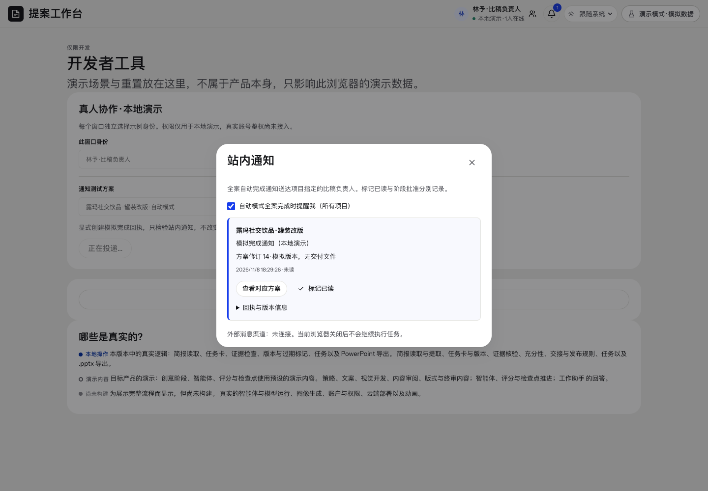

# 全局协作与通知 · 页面开发规格

规范版本：1.0.1。页面ID：`team`。状态：已确认要求汇编；本次整理待核对。负责人见[proposal-director](../agents/proposal-director.md)。

这是页面显示、状态与交互合同；业务做法由岗位和方法承担，页面实现不自行改变业务门禁。共同视觉规则见[桌面UI基线](../specs/ui-system.md)。

## 使用任务

知道哪些人类成员在线、各自能做什么、意见是否处理、完成后通知谁。

## 入口

右上角人类姓名、角色、人数和成员详情；与AI任务运行状态分开。阶段想法绑定对象／版本。

## 权限

游客只读，无编辑、交流、批准或助手能力；其余细分权限沿用本地已实施矩阵，生产权限仍需真实服务验证。

## 通知

自动模式真实整案完成后通知人类比稿负责人；项目、run、交付版本、修订和回执绑定且幂等。渠道账号未确定，本地收件箱不等于外部艾特或夜间后台。

## 已确认要求清单

- 右上显示人类在线姓名、角色和成员详情，区别于AI任务状态。
- 比稿负责人、使用者、人类视觉负责人、设计师、游客五种人类角色。
- 游客只查看，不能编辑、批准、交流或使用助手。
- 自动模式完成整案后通知或提及比稿负责人，不在单阶段完成时冒称全案完成。

- 意见绑定实际对象与版本；真人处理记录有理由。
- 本地窗口在线必须明确是本地演示。

## 本页验收与接入核对

- 人类项目决定权与AI推荐分开。
- 完成通知需要真实完整回执，不能只看到了最后阶段。

### 本次接入快照

以下是2026-11-11核对时的实现信息，不是长期门槛；实际进度继续从[状态导航](../../status/current.md)和原生回执读取。后续状态变化不倒写此快照。

- 真实账号、跨设备在线、夜间后台及外部艾特仍待正式接入。

复验主阅读顺序、相关操作、长内容／错误状态、目标桌面与边界；按[UI审核岗位](../agents/ui-review-owner.md)记录实际范围。尚未接线的动作显示真实状态，不以示例按钮冒充能力。

## 可比对界面

notification-inbox.png。既有界面留档，不证明所有现行要求已实现或获批。原图身份见[截图来源清单](../specs/screenshot-provenance.json)。

## 来源与版本

要求来源：现有[用户决定索引](../specs/decisions.md)、[版本沿革](../handoffs/提案工作台_版本沿革与已确认要求_20261111.md)及本次[来源清单](../specs/source-provenance.json)。图像是证据，不覆盖当前文字要求。新需求通过[变更与PR规则](../specs/change-control.md)更新本文件版本。
