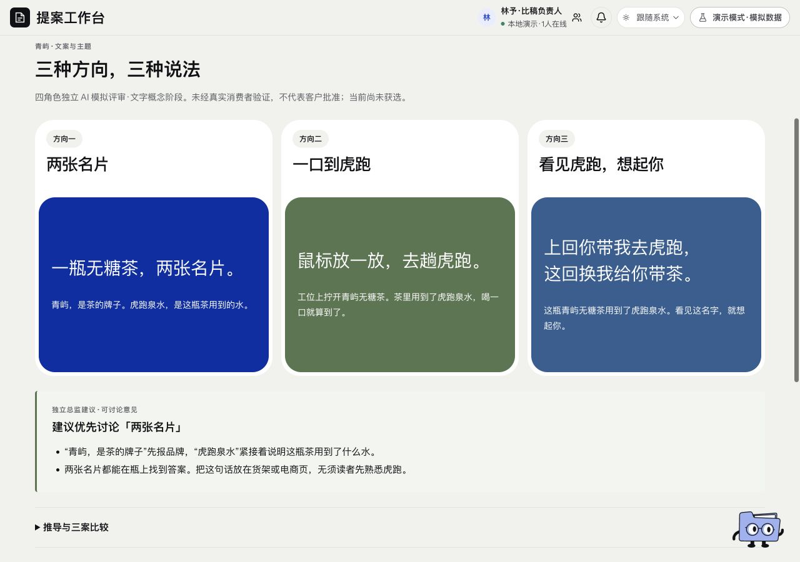

# 文案与主题 · 页面开发规格

规范版本：1.13.0。页面ID：`themes`。状态：已确认要求汇编；本次整理待核对。负责人见[copy-owner](../agents/copy-owner.md)。

这是页面显示、状态与交互合同；业务做法由岗位和方法承担，页面实现不自行改变业务门禁。共同视觉规则见[桌面UI基线](../specs/ui-system.md)。

## 夜航阶段详情

三个方向并排显示，每张卡只放完整主标题。方向位置、稿件已登记的创作职责、本版推荐与实际选定状态用卡眉表示。点卡切换评审对象；协作模式的采用操作单独记录，浏览不会采用。没有主标题则显示「主标题待补」。

通过后提供本案可展开的创作底稿，逐案展示原始候选、淘汰理由、打磨版本和双团改稿记录。旧稿按原有资料展示。

## 评审详情

现行单标题评审（`version: 3`、`dual-panel-headline-v4`）展开后先读本案裁定。三项共通要求分别是「事实准确，归属清楚」「单句读得懂，念得顺」「能接上本案策略」。第四项读取这张卡实际承担的任务，即稳健延续、品牌或产品特征放大、用户氛围或情绪放大之一。每项显示独立总监实际给出的通过状态、标题依据与理由，缺件显示待核。卡位顺序不决定任务。

组内差异另列 AB、AC、BC 的逐对裁定与依据，并展示整组状态。推荐独立给出方向、理由、记忆点、如何复述、使用场景及取舍。四岗只显示各自实际观察的项目，允许不同岗位关注同一点。总监的每案四项裁定必须齐全。四岗观察、对抗异议、裁定和复核能按案展开，岗位低分和异议保留原值；单案发布依据是四项裁定，岗位分不设统一放行线。整页只展示主标题，不补写副文或触点。

`dual-panel-headline-v3` 的历史单标题票显示当时的逐岗维度与分数，不折算为四项裁定；`dual-panel-v2` 沿用旧版主副文合读身份。原判纠正和改稿复核各自绑定对应稿件。

旧稿只投影其主标题。旧版推荐按当时的主副文合读口径明确标记。正文、旧票、场景示例、原件下载与全文执行记录保存在后台。业务页的折叠项也不得复现原副文或触点。研究、策略、视觉与其他阶段的原件入口沿用各自页面规则。

## 青屿只读样例

默认展示已发布的提炼规则稿标题。只有完整 Skill 实验稿的三个标题各有四岗原观察、本案四项裁定全部通过、整组通过、三对差异成立且推荐三项依据齐全，并带本轮裁定回执时，才切为实验稿。否则继续显示旧标题，保留旧评口径。实验稿可逐卡对照另一版同一卡位的主标题。历史入口展示历史标题及当时推荐口径。

## 状态

初稿／改稿／待复核／建议讨论／人类已选分开；独立模拟不冒称客户同意或全程盲评。

## 已确认要求清单

- 从策略拉开三个实质不同创意方向，不是同义改写或换色。
- 文案、品牌、用户模拟、传播分别评价，提出具体问题，改稿后复核。
- 创作、原票、对应异议和独立裁定分开，推荐与用户选定分开。

- 主层呈现三个标题及推荐标记，评审详情按当前方向展开。
- 推导、评分、异议和修改记录默认收起，按需展开。
- 原始评分与后续复核并列，不把复核覆盖原分。

## 本页验收与接入核对

- 原票、实际稿件与版本对应；有实质阻断就交回修改。
- 盲审需隔离作者推荐与其他裁判意见；青屿已读作者回应的评分不能称全程盲评。

### 本次接入快照

以下是2026-11-11核对时的实现信息，不是长期门槛；实际进度继续从[状态导航](../../status/current.md)和原生回执读取。后续状态变化不倒写此快照。

- 四角色均为AI模拟，不是真实客户、消费者或传播实测。
- “两张名片”只是总监建议优先讨论，没有用户选案或包装效果通过。

复验主阅读顺序、相关操作、长内容／错误状态、目标桌面与边界；按[UI审核岗位](../agents/ui-review-owner.md)记录实际范围。尚未接线的动作显示真实状态，不以示例按钮冒充能力。

## 可比对界面

当前三方向主副文与推荐，1280桌面。既有界面留档，不证明所有现行要求已实现或获批。原图身份见[截图来源清单](../specs/screenshot-provenance.json)。

## 来源与版本

当前COPY入口按[运行合同](../development/simple-copy.md)区分已保存原稿、原四岗报告、人类采用及技术衔接。pending或当前scope的旧推进结果未记录时，保留原文/原票并停止继续；不会自动重派或把历史结果补成已完成。已保存的新原结果折叠查看，页面刷新只核对原请求。

要求来源：现有[用户决定索引](../specs/decisions.md)、[版本沿革](../handoffs/提案工作台_版本沿革与已确认要求_20261111.md)及本次[来源清单](../specs/source-provenance.json)。图像是证据，不覆盖当前文字要求。新需求通过[变更与PR规则](../specs/change-control.md)更新本文件版本。

## 当前HTTP文案工作区

可选`copyWorkflow`读取当前SIMPLE双负责人接收后生成的实际三方向。此段为早期独立工作区记录。夜航文案业务页按上面的单标题口径显示。Mock及青屿保留原身份，不补生产能力。

页面按当前阶段显示**继续负责人交接**、**生成三方向文案**、**继续文案核验**或**继续独立评审**。每次仅执行本次已安排的工作，刷新只读。全文核验和四岗评审分别登记、分别完成，原文、双负责人原报告、首读评分、对应异议及裁定放在详情中。原生综合门槛判断与人类选案分开。

历史、缺配置、缺上游、未知和错误分别呈现。原结果未知时停止执行并保留原记录，本入口未接下游原件恢复。文案改稿再评和视觉继续尚未接线，不用按钮或保存状态冒充完成。GET报告未逐份物理重验全部原票，完整17节点packet与执行输入绑定仅证明投影准入。接口和门禁见[文案运行合同](../development/simple-copy.md)。当前根实际UI及最终验收另按真实回执登记。
