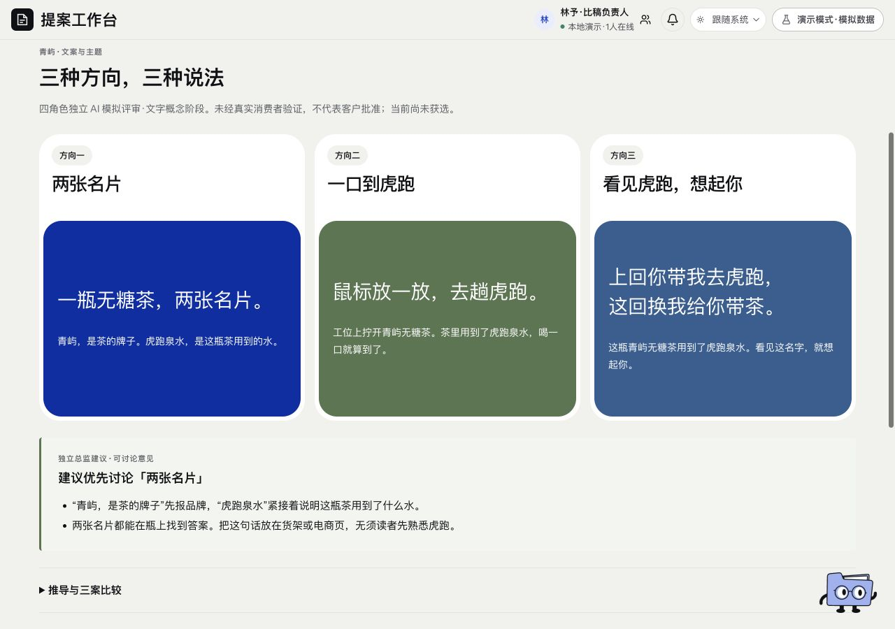

# 文案与主题 · 页面开发规格

规范版本：1.0.1。页面ID：`themes`。状态：已确认要求汇编；本次整理待核对。负责人见[copy-owner](../agents/copy-owner.md)。

这是页面显示、状态与交互合同；业务做法由岗位和方法承担，页面实现不自行改变业务门禁。共同视觉规则见[桌面UI基线](../specs/ui-system.md)。

## 使用任务

比较三个真正不同的创意方向，理解为什么推荐，再决定后续视觉方向。

## 主层

三个方向、主副文和推荐理由，保留与当前策略的承接。推荐和人类选定分开。

## 展开

四岗评分及维度、对应异议、原分与追加复核、改稿对照和历史。完整信息可读，但不同时堆在主层。

## 状态

初稿／改稿／待复核／建议讨论／人类已选分开；独立模拟不冒称客户同意或全程盲评。

## 已确认要求清单

- 从策略拉开三个实质不同创意方向，不是同义改写或换色。
- 文案、品牌、用户模拟、传播分别评价，提出具体问题，改稿后复核。
- 创作、原票、对应异议和独立裁定分开，推荐与用户选定分开。

- 主层只显示方向、主副文和推荐理由。
- 推导、评分、异议和修改记录默认收起，按需展开。
- 原始评分与后续复核并列，不把复核覆盖原分。

## 本页验收与接入核对

- 原票、实际稿件与版本对应；有实质阻断就交回修改。
- 盲审需隔离作者推荐与其他裁判意见；青屿已读作者回应的评分不能称全程盲评。

### 本次接入快照

以下是2026-11-11核对时的实现信息，不是长期门槛；实际进度继续从[状态导航](../../status/current.md)和原生回执读取。后续状态变化不倒写此快照。

- 四角色均为AI模拟，不是真实客户、消费者或传播实测。
- “两张名片”只是总监建议优先讨论，没有用户选案或包装效果通过。

复验主阅读顺序、相关操作、长内容／错误状态、目标桌面与边界；按[UI审核岗位](../agents/ui-review-owner.md)记录实际范围。尚未接线的动作显示真实状态，不以示例按钮冒充能力。

## 可比对界面

当前三方向主副文与推荐，1280桌面。既有界面留档，不证明所有现行要求已实现或获批。原图身份见[截图来源清单](../specs/screenshot-provenance.json)。

## 来源与版本

要求来源：现有[用户决定索引](../specs/decisions.md)、[版本沿革](../handoffs/提案工作台_版本沿革与已确认要求_20261111.md)及本次[来源清单](../specs/source-provenance.json)。图像是证据，不覆盖当前文字要求。新需求通过[变更与PR规则](../specs/change-control.md)更新本文件版本。
