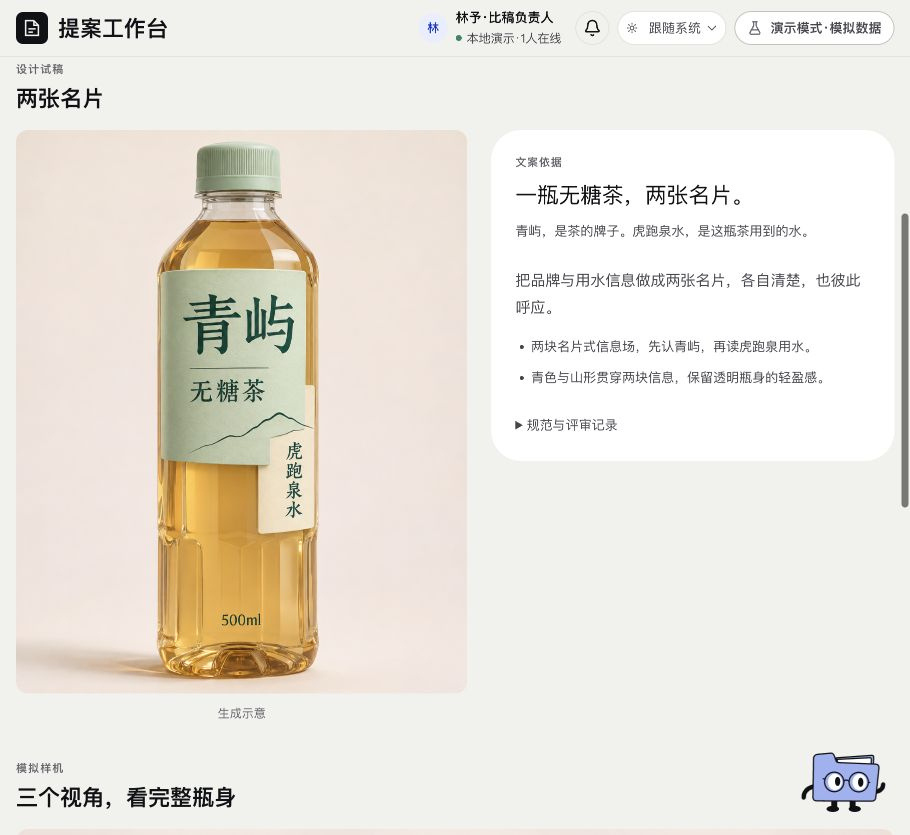

# 视觉开发 · 页面开发规格

规范版本：1.1.0。页面ID：`visual`。状态：已确认要求汇编；本次整理待核对。负责人见[visual-owner](../agents/visual-owner.md)。

这是页面显示、状态与交互合同；业务做法由岗位和方法承担，页面实现不自行改变业务门禁。共同视觉规则见[桌面UI基线](../specs/ui-system.md)。

## 使用任务

按方向查看真实参考、草图探索、当前成稿、样机与评审，理解下一步。

## 保留版式

方向切换、大图与右侧评审、扇面参考、三纸页文件夹草图、样机和方向对照。不要恢复用户退回的紧凑空稿与常驻规范挤压大图的版式。

## 内容

参考每图一句借鉴；草图有实质构图差异；当前图、原图来源、样机及阶段真实状态分别显示。规范、完整来源及过程可展开，协作入口保持唯一。

## 状态与动作

缺图明确尚未生成，已有图真实加载；放大、切换方向和样机有焦点恢复。阶段准入与授权依Skill，补图不回填通过。

## 已确认要求清单

- 参考→独立适用性审查→冻结主辅备用与借鉴边界→每方向三种实质不同草图→选优深化→成稿复核及整组三方向比较。
- 参考优先实际原图，写明借鉴与禁止照搬；按包装/KV附录适配。
- 创作者不能自签独立通过，独立总监保留原票而不改分。

- 三方向切换；当前稿、参考与草图、三方向对照三个阅读入口。
- 参考扇面、三纸页草图文件夹、左大图右文案评审与可放大样机保留。
- 规范、版本和细节收起，不常驻挤压主区；协作前置，减少重复待制作与评分空壳。

## 本页验收与接入核对

- 参考必评适用项逐项≥4；草图/成稿四岗整体原票未舍入均分≥4，缺票不缩分母。
- 关键未知与成立硬伤另行阻断；结构通过不等于精修通过。
- 常规最多三次修改，达标早停，超限暂停；旧额外专项三次不默认启用。

### 本次接入快照

以下是2026-11-11核对时的实现信息，不是长期门槛；实际进度继续从[状态导航](../../status/current.md)和原生回执读取。后续状态变化不倒写此快照。

- 当前15图是设计试稿，不代表正式参考/草图/精修回环已全部通过，也不是印前文件。
- 规范已采用，不表示任意Brief后台自动调度或真实审美模型已接通。

复验主阅读顺序、相关操作、长内容／错误状态、目标桌面与边界；按[UI审核岗位](../agents/ui-review-owner.md)记录实际范围。尚未接线的动作显示真实状态，不以示例按钮冒充能力。

## 可比对界面

当前主图与右侧文案说明。既有界面留档，不证明所有现行要求已实现或获批。原图身份见[截图来源清单](../specs/screenshot-provenance.json)。

## 来源与版本

要求来源：现有[用户决定索引](../specs/decisions.md)、[版本沿革](../handoffs/提案工作台_版本沿革与已确认要求_20261111.md)及本次[来源清单](../specs/source-provenance.json)。图像是证据，不覆盖当前文字要求。新需求通过[变更与PR规则](../specs/change-control.md)更新本文件版本。

## 当前HTTP参考入口

按[受限运行合同](../development/visual-workflow.md)读取同版真实原图、借鉴用途、参考判定及初始129节点。沿用方向切换与原图扇面，详细原报告、原生阻断和来源折叠；生产报告与评审统一称原报告，不把数量写成通过。

执行不可用仍可阅读。当前UI原图保存也随执行可用性禁用，后端storage-only能力尚未独立映射，不声称默认可上传。刷新或查询失败锁定新写，旧有草稿保留；旧衔接未记录、真正未知与advance_pending分别说明，不能继续重派。明确采用仍核原版身份、权限与理由。

当前参考组件的实际复验不覆盖完整App、草图/v2版式和采用、深化或样机。新阶段映射必须核原任务、原图及真实报告后另验，不用参考图填充草图空态，也不以metadata样本签视觉质量。
