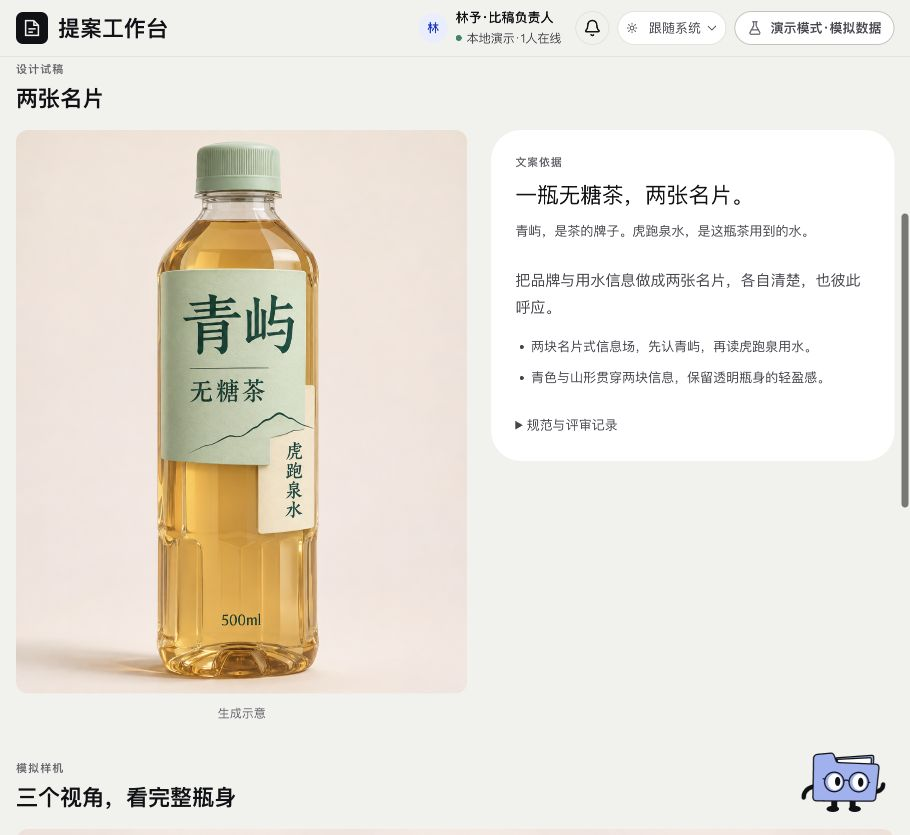

# 视觉开发 · 页面开发规格

规范版本：1.4.0。页面ID：`visual`。状态：已确认要求汇编；本次整理待核对。负责人见[visual-owner](../agents/visual-owner.md)。

这是页面显示、状态与交互合同；业务做法由岗位和方法承担，页面实现不自行改变业务门禁。共同视觉规则见[桌面UI基线](../specs/ui-system.md)。

## 夜航阶段详情

上半页纵向排列三个方向，每行显示方向名和三张本案参考缩略图。行首可切换当前查看的方向，选中行具有可见状态。参考图可打开原图。项目共用或尚未归到方向的材料在说明里单列；方向缺图显示缺项，避免把一张图重复填进不同位置。

下半页始终只看当前一案。第一排左侧看草图，右侧看主视觉；第二排用一张通栏样机图看应用效果。一个方向有多张草图时保留逐张查看入口。青屿三案各有三张草图、一张包装主图、一张正侧背三视角样机图板。切换方向同步替换三处图稿，可通过深链接直接打开指定方向。

主层文字限方向名、图名和必要的操作与缺件状态。说明、主标题依据、资料来源、设计限制和评审记录点开再看，按所选方向显示。浏览、放大、切图均为只读操作。正式采用、生成和评分由各自的业务记录决定。

## 青屿已有图片的来源

六张已登记参考保持原件与原归属。为每行显示第三张，A 补入研究 R4 的淳茶舍冷萃乌龙单品图，B 补入同一研究的伊刻活泉现泡茉莉花茶，C 展示已归档的可口可乐分享瓶称呼系列全图。C 的两瓶近景与白底系列图分别展示单瓶称呼和整套变化，均属同一品牌项目。这些是本次页面展示选择，独立参考评审及业务采用仍以原票为准。

## 已确认要求清单

- 参考→独立适用性审查→冻结主辅备用与借鉴边界→每方向三种实质不同草图→选优深化→成稿复核及整组三方向比较。
- 参考优先实际原图，写明借鉴与禁止照搬；按包装/KV附录适配。
- 创作者不能自签独立通过，独立总监保留原票而不改分。

- 逐案核对三张参考的真实来源、草图与主视觉的并排位置、宽样机，以及放大、切换和收起详情后的焦点。
- 未收到独立评审时在详情说明实际状态，文案评分不转作视觉评分。

## 本页验收与接入核对

- 参考必评适用项逐项≥4；草图/成稿四岗整体原票未舍入均分≥4，缺票不缩分母。
- 关键未知与成立硬伤另行阻断；结构通过不等于精修通过。
- 常规最多三次修改，达标早停，超限暂停；旧额外专项三次不默认启用。

### 本次接入快照

以下是2026-11-11核对时的实现信息，不是长期门槛；实际进度继续从[状态导航](../../status/current.md)和原生回执读取。后续状态变化不倒写此快照。

- 当前15图是设计试稿，不代表正式参考/草图/精修回环已全部通过，也不是印前文件。
- 规范已采用，不表示任意Brief后台自动调度或真实审美模型已接通。

复验主阅读顺序、相关操作、长内容／错误状态、目标桌面与边界；按[UI审核岗位](../agents/ui-review-owner.md)记录实际范围。尚未接线的动作显示真实状态，不以示例按钮冒充能力。

## 可比对界面

历史版的主图与右侧文案说明。既有界面留档，不证明所有现行要求已实现或获批。原图身份见[截图来源清单](../specs/screenshot-provenance.json)。

## 来源与版本

要求来源：现有[用户决定索引](../specs/decisions.md)、[版本沿革](../handoffs/提案工作台_版本沿革与已确认要求_20261111.md)及本次[来源清单](../specs/source-provenance.json)。图像是证据，不覆盖当前文字要求。新需求通过[变更与PR规则](../specs/change-control.md)更新本文件版本。

## 当前HTTP参考入口

按[受限运行合同](../development/visual-workflow.md)读取同版真实原图、借鉴用途、参考判定及初始129节点。该早期入口保留方向切换与原图扇面，详细原报告、原生阻断和来源折叠；生产报告与评审统一称原报告，不把数量写成通过。

执行不可用仍可阅读。原图保存与借鉴登记分别映射显式storage能力；模型关闭时可准备原件，缺storage字段的旧服务默认禁用。执行、组合与采用仍按原执行资格。表单填充、按钮可用和实际HTTP落盘分别验证，不把只读UI核验写成保存成功。刷新或查询失败锁定新写，旧有草稿保留；旧衔接未记录、真正未知与advance_pending分别说明，不能继续重派。明确采用仍核原版身份、权限与理由。

当前参考组件的实际复验不覆盖完整App、草图/v2版式和采用、深化或样机。新阶段映射必须核原任务、原图及真实报告后另验，不用参考图填充草图空态，也不以metadata样本签视觉质量。
