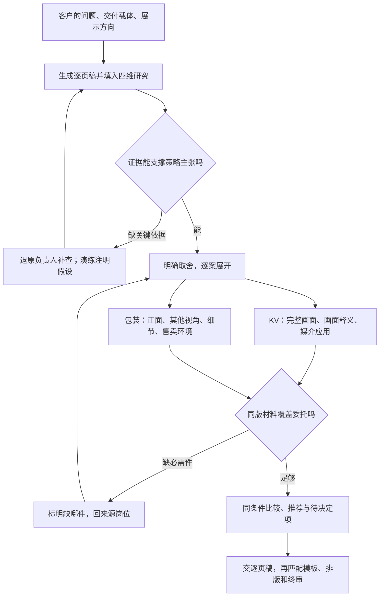

# 客户提案从逐页编稿到排版

规范版本：1.1.0。适用包装和 KV 的本地编稿试行。入口是[提案结构 Skill](../../skills/proposal-structure-pilot/SKILL.md)。各阶段的工作记录是内容来源，客户翻看的次序由本案要解决的问题和作品决定。

## 翻开一份方案会看到什么

以三方向、单品包装、两个售卖触点的基础配置为例：

| 页码 | 客户能看到什么 |
|---|---|
| 1–3 | 封面、能定位每个方向的目录、本次要解决的包装问题。 |
| 4–8 | 品类数据或样本、本品牌现貌、同类包装正面对照、人群购买情境、产品可兑现的事实。每页点明“这会怎样改变设计”。 |
| 9–11 | 从研究得出判断，将机会与产品和人群对上，决定先放大什么。 |
| 12 | 三个解法分别用一句创意说明。 |
| 13–18、19–24、25–30 | A、B、C 依次展开。每案按同序看主题、正面、侧背、细节、货架和第二购买触点。 |
| 31–33 | 同尺度比较及推荐、本次请客户决定什么、封底。 |

换成双方向 KV，前 12 页的职责相同。第 13–17 页与第 18–22 页分别讲一案的主题、完整主画面、画面释义和两个媒介应用，第 23–25 页收尾。若简报另交竖版和动效，每案分别多一页完整竖稿和一页动态帧序。制作草图、品牌活动、SKU 展开按实际委托和材料增减，目录随本稿重排。这些页码演示用法；客户提出的载体、授权方向和实际作品决定成稿长度。

## 谁决定什么

比稿 Agent 组织逐页编稿，研究、策略、文案、视觉负责人分别确认自己提供的材料身份与适用范围。每页至少能回答“客户看到什么，从什么材料知道，这和选方案有什么关系”。关键证据或同版作品不足，由其来源岗位补齐。人群行为另有来源才能当作研究发现，AI 场景图只帮助说明情境。

排版接收页序、可见标题、判断或作品、版本和缺口。再登记 Logo、VI 色、已授权的项目色与画幅，选 Deck Studio 可用的模板，逐页配图、处理容量和原生可编辑导出。拆页保留原页映射，改变策略、方向或推荐时回到比稿 Agent。终审检查实际 Deck 和导出，客户采用依据单独记录。

## 各份资料怎么用

- 固定顺序、填充项、材料要求和逐页判据以[页库](../../skills/proposal-structure-pilot/references/page-library.json)为准；[本地生成器](../../skills/proposal-structure-pilot/scripts/build_outline.py)直接读这一份。六份历史原案的出处和适用边界见[案例索引](../../skills/proposal-structure-pilot/references/cases.md)。
- [排版 Skill](../../skills/proposal-layout-pilot/SKILL.md)负责页型与可读性；[工作台版式页规格](../pages/layout.md)负责浏览、翻页和下载。既有青屿 23 页 Deck 及单案逐页拆解保留为案例。
- 夜航在人工采用本版视觉后，按同一页库组织可识别的包装、KV 项目。协作模式展开已选方案，自动模式展开各方向的采用稿。缺整页材料时记录待补，已有判断但资料不全时说明限制。版式详情可以翻页，在“逐页稿与材料”查看出处与缺件，并下载同 Deck 编译的 PPTX。历史成品沿用本来的目录与页数。
